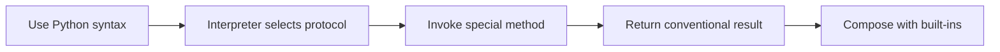

> **Level 2: Intermediate** · Topic 9 of 35

[← Abstraction](./08-abstraction.md) · [↑ Level index](../README.md) · [Iterators →](./10-iterators.md)

# Magic Methods

## Overview
- **What is it?** Magic methods (dunder methods) integrate custom types with Python's data model for operators, iteration, and representation.
- **Why is it important?** They make domain objects feel native—comparable, printable, hashable, or context-managed—without awkward helper APIs.
- **Where is it used?** Value objects, collections, ORMs, DSLs, and any type that should support operators or protocols.

## Learning Objectives
- Map Python operations to special methods.
- Return NotImplemented for unsupported comparisons.
- Keep operator semantics unsurprising.

## Real World Applications
- Compare Money or Version objects with readable operators.
- Make containers iterable and length-aware with __iter__ and __len__.
- Control debug output via __repr__ for faster incident diagnosis.

## Core Concepts

### Protocol hooks
- **Definition:** A magic or dunder method is a data-model hook invoked by Python syntax or a built-in operation.
- **Visual explanation:** ``len(box) -> box.__len__()``
- **Practical example:**

```python
class Box:
    def __len__(self):
        return 3

print(len(Box()))
```

### Representations
- **Definition:** __repr__ should provide an unambiguous developer-facing representation; __str__ may be friendlier for users.
- **Visual explanation:** ``repr(object): diagnostic | str(object): display``
- **Practical example:**

```python
class Tag:
    def __repr__(self):
        return "Tag('python')"
```

### Binary operation dispatch
- **Definition:** For unsupported operand types, comparison and arithmetic hooks should return NotImplemented so reflected operations or errors can proceed.
- **Visual explanation:** ``left.__add__ -> NotImplemented -> right.__radd__``
- **Practical example:**

```python
class Distance:
    def __eq__(self, other):
        if not isinstance(other, Distance):
            return NotImplemented
        return self.meters == other.meters
```

## Infographic Summary

| Infographic Block | Topic-specific guidance |
| --- | --- |
| 📌 Concept | Magic methods (dunder methods) integrate custom types with Python's data model for operators, iteration, and representation. |
| ⚡ Purpose | Methods such as __repr__, __len__, and __eq__ let syntax and built-ins delegate to your type. |
| 🔥 Benefits | Custom types that compose naturally with Python syntax, operators, and built-ins. |
| 🎯 Use Cases | value objects, collection-like types, context-aware resources |
| 🚀 Best Practices | Implement only protocols whose semantics naturally fit the type. |
| ❌ Common Mistakes | Calling special methods directly instead of using len(), iteration, or operators. |

## Syntax Guide

### Basic Syntax

```python
class Batch:
    def __init__(self, records):
        self.records = list(records)

    def __len__(self):
        return len(self.records)
```

### Standard Structure

```python
class Identifier:
    def __init__(self, value):
        self.value = value

    def __repr__(self):
        return f"Identifier({self.value!r})"

    def __eq__(self, other):
        if not isinstance(other, Identifier):
            return NotImplemented
        return self.value == other.value
```

### Code Pattern

```python
# Python operation -> special-method protocol
# Validate the other operand's type.
# Return a value with conventional semantics.
# Return NotImplemented when unsupported.
```

## Examples

### Beginner Example

```python
class Playlist:
    def __init__(self, tracks):
        self.tracks = list(tracks)

    def __len__(self):
        return len(self.tracks)

playlist = Playlist(["Intro", "Finale"])
print(len(playlist))
```

### Intermediate Example

```python
class Version:
    def __init__(self, major: int, minor: int):
        self.major, self.minor = major, minor

    def __repr__(self):
        return f"Version({self.major}, {self.minor})"

    def __eq__(self, other):
        if not isinstance(other, Version):
            return NotImplemented
        return (self.major, self.minor) == (other.major, other.minor)

print(Version(3, 12), Version(3, 12) == Version(3, 12))
```

### Advanced Example

```python
from dataclasses import dataclass

@dataclass(frozen=True)
class Vector:
    x: float
    y: float

    def __add__(self, other):
        if not isinstance(other, Vector):
            return NotImplemented
        return Vector(self.x + other.x, self.y + other.y)

    def __iter__(self):
        yield self.x
        yield self.y

    def __bool__(self):
        return bool(self.x or self.y)

result = Vector(1, 2) + Vector(3, 4)
print(tuple(result), bool(result))
```

## Workflow Diagram



---

[← Abstraction](./08-abstraction.md) · [↑ Level index](../README.md) · [Iterators →](./10-iterators.md)
