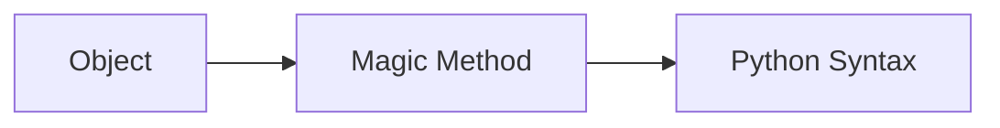

# Magic Methods

## Overview

- **What is it?** Magic methods (dunders) customize operator and protocol behavior.
- **Why is it important?** They make user-defined objects feel like built-ins.
- **Where is it used?** Domain models, containers, context managers, iterators.

## Learning Objectives

- **Skills gained:** Practical command of Magic Methods.
- **Concepts covered:**

- Implement __repr__, __str__, __len__, __eq__.
- Support context manager and iteration protocols.
- Avoid overloading operators without need.

- **Expected outcome:** You make classes Pythonic and interoperable with syntax.

## Real World Applications

- Numeric libs
- Custom collections
- ORM fields
- Simulation

- **Business applications:** Automate workflows, reduce manual errors, accelerate delivery.
- **Career relevance:** Required knowledge for Python roles from junior developer to senior engineer.

## Core Concepts

### __repr__

- **Definition:** Unambiguous debug representation.
- **Visual explanation:** `__repr__` → process → result
- **Practical example:**

```python
class Point:
    def __init__(self, x, y):
        self.x, self.y = x, y
    def __repr__(self):
        return f'Point({self.x}, {self.y})'
print(repr(Point(1,2)))
```

### __eq__

- **Definition:** Value equality.
- **Visual explanation:** `__eq__` → process → result
- **Practical example:**

```python
class V:
    def __init__(self, n):
        self.n = n
    def __eq__(self, other):
        return isinstance(other, V) and self.n == other.n
print(V(1) == V(1))
```

### __len__

- **Definition:** Support len(obj).
- **Visual explanation:** `__len__` → process → result
- **Practical example:**

```python
class Bag:
    def __init__(self, items):
        self.items = items
    def __len__(self):
        return len(self.items)
print(len(Bag([1,2])))
```

## Infographic Summary

| Block | Summary |
| --- | --- |
| 📌 Concept | Dunders hook into Python data model. |
| ⚡ Purpose | Integrate objects with language features. |
| 🔥 Benefits | Readable syntax, less boilerplate at call sites. |
| 🎯 Use Cases | Vectors, stacks, money types, smart paths. |
| 🚀 Best Practices | Keep semantics intuitive; document equality/hash contract. |
| ❌ Common Mistakes | Broken __hash__ with mutable __eq__, surprising operators. |

## Syntax Guide

### Basic Syntax

```python
def __repr__(self):
    return f'MyObj({self.id})'
```

### Standard Structure

```python
identify protocol -> implement dunders -> test
```

### Code Pattern

```python
def __enter__(self):
    return self
```

## Examples

### Beginner Example

```python
class Title:
    def __init__(self, text):
        self.text = text
    def __str__(self):
        return self.text.upper()
print(str(Title('hi')))
```

### Intermediate Example

```python
class Stack:
    def __init__(self):
        self._items = []

    def push(self, item):
        self._items.append(item)

    def __len__(self):
        return len(self._items)


s = Stack()
s.push(1)
print(len(s))
```

### Advanced Example

```python
class Vector:
    def __init__(self, x: float, y: float):
        self.x, self.y = x, y

    def __add__(self, other: 'Vector') -> 'Vector':
        return Vector(self.x + other.x, self.y + other.y)

    def __repr__(self) -> str:
        return f'Vector({self.x}, {self.y})'


print(Vector(1, 2) + Vector(3, 4))
```

## Workflow Diagram



---
