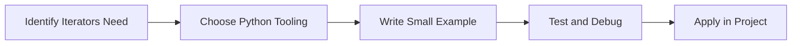

> **Level 2: Intermediate** · Topic 10 of 35

[← Magic Methods](./09-magic-methods.md) · [↑ Level index](../README.md) · [Generators →](./11-generators.md)

# Iterators

## Overview
- **What is it?** Iterators is a Python knowledge area focused on professional Python patterns.
- **Why is it important?** Help developers apply professional Python patterns techniques safely, clearly, and consistently.
- **Where is it used?** Data exchange, observability, clean abstractions, and production utilities.

## Learning Objectives
- Gain the practical skill to explain, write, debug, and review iterators code.
- Cover the vocabulary, syntax, workflow, edge cases, and professional habits behind iterators.
- Expected outcome: you can use iterators in a small project and recognize when it belongs in production code.

## Real World Applications
- **Industry use cases:** Data exchange, observability, clean abstractions, and production utilities.
- **Business applications:** Reduce manual work, improve reliability, support reporting, automate decisions, and ship maintainable features.
- **Career relevance:** Supports Python developer, backend engineer, data engineer, AI engineer, DevOps engineer, QA automation, and cybersecurity automation roles.

## Core Concepts

### Mental Model
- **Definition:** The main idea that gives iterators its structure and purpose inside a Python program.
- **Visual explanation:** `problem -> Iterators model -> clear code`
- **Practical example:**

```python
apply_iterators_label = "Iterators"
print(apply_iterators_label)
```

### Execution Flow
- **Definition:** The ordered steps Python follows when iterators code is created, executed, or integrated.
- **Visual explanation:** `input -> Python operation -> result -> feedback`
- **Practical example:**

```python
def countdown(start):
    while start > 0:
        yield start
        start -= 1

print(list(countdown(3)))
```

### Quality Rule
- **Definition:** The reliability habit that keeps iterators understandable, testable, secure, and maintainable.
- **Visual explanation:** `working code -> validation -> production confidence`
- **Practical example:**

```python
def read_batches(rows, size):
    for index in range(0, len(rows), size):
        yield rows[index:index + size]

print(list(read_batches([1, 2, 3, 4], 2)))
```

## Infographic Summary

| Infographic Block | Key Message |
| --- | --- |
| 📌 Concept | Iterators belongs to the professional Python patterns part of Python mastery. |
| ⚡ Purpose | Help developers apply professional Python patterns techniques safely, clearly, and consistently. |
| 🔥 Benefits | Stronger maintainability, better reliability, and more professional professional Python patterns decisions. |
| 🎯 Use Cases | Data exchange, observability, clean abstractions, and production utilities. |
| 🚀 Best Practices | Prefer readable names, small examples, explicit errors, tests, documentation, and version-aware choices. |
| ❌ Common Mistakes | Copying code without understanding it, ignoring edge cases, skipping validation, and mixing unrelated responsibilities. |

## Syntax Guide

### Basic Syntax

```python
def numbers():
    yield 1
    yield 2
```

### Standard Structure

```python
def apply_iterators(value):
    """Apply the Iterators concept to one value."""
    return value

result = apply_iterators("practice")
print(result)
```

### Code Pattern

```python
# 1. Identify the Iterators problem
# 2. Apply the correct Python structure
# 3. Validate the result with tests or output
```

## Examples

### Beginner Example

```python
def countdown(start):
    while start > 0:
        yield start
        start -= 1

print(list(countdown(3)))
```

### Intermediate Example

```python
def read_batches(rows, size):
    for index in range(0, len(rows), size):
        yield rows[index:index + size]

print(list(read_batches([1, 2, 3, 4], 2)))
```

### Advanced Example

```python
def pipeline(values):
    yield from (value * value for value in values if value % 2 == 0)

print(list(pipeline(range(10))))
```

## Workflow Diagram




---

---

[← Magic Methods](./09-magic-methods.md) · [↑ Level index](../README.md) · [Generators →](./11-generators.md)
