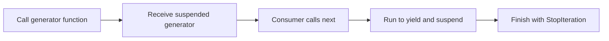

> **Level 2: Intermediate** · Topic 11 of 35

[← Iterators](./10-iterators.md) · [↑ Level index](../README.md) · [Decorators →](./12-decorators.md)

# Generators

## Overview
- **What is it?** Generators create lazy iterators with yield (and generator expressions) that pause and resume execution.
- **Why is it important?** They simplify streaming pipelines and reduce memory use compared with building full intermediate lists.
- **Where is it used?** ETL transforms, event streams, recursive tree walks, and incremental report generation.

## Learning Objectives
- Explain yield suspension.
- Contrast generator functions with ordinary functions.
- Compose lazy pipelines without retaining all data.

## Real World Applications
- Yield cleaned CSV rows as they are parsed.
- Produce batches for bulk database inserts.
- Traverse filesystem trees without materializing every path first.

## Core Concepts

### Generator functions
- **Definition:** Calling a function containing yield returns a generator immediately; its body runs only as values are requested.
- **Visual explanation:** ``call -> generator; next -> run until yield -> suspend``
- **Practical example:**

```python
def ids():
    yield 1
    yield 2

print(list(ids()))
```

### Generator state
- **Definition:** Local variables and the instruction position remain stored in the suspended generator frame.
- **Visual explanation:** ``yield value + preserve locals -> resume later``
- **Practical example:**

```python
def countdown(n):
    while n:
        yield n
        n -= 1
```

### Lazy composition
- **Definition:** Generator expressions and yield from connect stages so only demanded items move through the pipeline.
- **Visual explanation:** ``source -> lazy filter -> lazy map -> consumer``
- **Practical example:**

```python
squares = (n * n for n in range(5))
print(next(squares))
```

## Infographic Summary

| Infographic Block | Topic-specific guidance |
| --- | --- |
| 📌 Concept | Generators create lazy iterators with yield (and generator expressions) that pause and resume execution. |
| ⚡ Purpose | A generator suspends its frame between values, providing iterator behavior without a manual state-machine class. |
| 🔥 Benefits | Lazy production, low memory use, and readable streaming pipelines without manual iterator classes. |
| 🎯 Use Cases | large-file pipelines, event streams, incremental transformations |
| 🚀 Best Practices | Use generators for single-pass streams and document whether iteration has side effects. |
| ❌ Common Mistakes | Converting a generator to a list before streaming benefits are needed. |

## Syntax Guide

### Basic Syntax

```python
def even_numbers(limit):
    for number in range(limit):
        if number % 2 == 0:
            yield number
```

### Standard Structure

```python
def normalized(lines):
    for line in lines:
        text = line.strip()
        if text:
            yield text.casefold()
```

### Code Pattern

```python
# Read one source item.
# Transform or filter it.
# yield one result and suspend.
# Resume only when the consumer asks.
```

## Examples

### Beginner Example

```python
def countdown(start: int):
    while start > 0:
        yield start
        start -= 1

for number in countdown(3):
    print(number)
```

### Intermediate Example

```python
def parsed_scores(lines):
    for line in lines:
        name, raw_score = line.split(",")
        yield name, int(raw_score)

passing = (
    name
    for name, score in parsed_scores(["Ada,91", "Lin,58", "Sam,84"])
    if score >= 60
)
print(list(passing))
```

### Advanced Example

```python
def read_chunks(text: str, size: int):
    for start in range(0, len(text), size):
        yield text[start:start + size]

def nonblank(chunks):
    for chunk in chunks:
        cleaned = chunk.strip()
        if cleaned:
            yield cleaned

def stream_document(text: str):
    yield from nonblank(read_chunks(text, 5))

stream = stream_document("alpha beta gamma")
print(next(stream))
print(list(stream))
```

## Workflow Diagram



---

[← Iterators](./10-iterators.md) · [↑ Level index](../README.md) · [Decorators →](./12-decorators.md)
