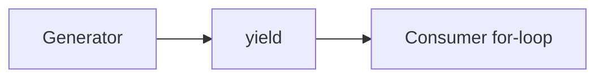

# Generators

## Overview

- **What is it?** Generators are iterators created by functions with yield.
- **Why is it important?** They simplify lazy pipelines with readable syntax.
- **Where is it used?** Streaming transforms, pagination, infinite sequences, coroutine precursors.

## Learning Objectives

- **Skills gained:** Practical command of Generators.
- **Concepts covered:**

- Write generator functions with yield.
- Use yield from for delegation.
- Chain generator pipelines.

- **Expected outcome:** You implement memory-efficient data pipelines with generators.

## Real World Applications

- ETL streaming
- Observability pipelines
- Audio processing
- Crawler fetch queues

- **Business applications:** Automate workflows, reduce manual errors, accelerate delivery.
- **Career relevance:** Required knowledge for Python roles from junior developer to senior engineer.

## Core Concepts

### yield

- **Definition:** Pauses function retaining state.
- **Visual explanation:** `yield` → process → result
- **Practical example:**

```python
def gen():
    yield 1
    yield 2
print(list(gen()))
```

### generator expr

- **Definition:** Like list comp but lazy.
- **Visual explanation:** `generator expr` → process → result
- **Practical example:**

```python
g = (x * x for x in range(3))
print(sum(g))
```

### yield from

- **Definition:** Delegate to sub-generator.
- **Visual explanation:** `yield from` → process → result
- **Practical example:**

```python
def a():
    yield from range(2)
print(list(a()))
```

## Infographic Summary

| Block | Summary |
| --- | --- |
| 📌 Concept | Generators produce values lazily via yield. |
| ⚡ Purpose | Stream processing with minimal memory. |
| 🔥 Benefits | Simple syntax, composable stages, fast startup. |
| 🎯 Use Cases | Log tailers, batch readers, fibonacci stream. |
| 🚀 Best Practices | Document exhaustion; close generators when needed. |
| ❌ Common Mistakes | Mixing return values with yield confusingly, not iterating once. |

## Syntax Guide

### Basic Syntax

```python
def count_to(n):
    for i in range(n):
        yield i
```

### Standard Structure

```python
produce -> yield -> resume -> StopIteration
```

### Code Pattern

```python
def read_chunks(f):
    while True:
        chunk = f.read(1024)
        if not chunk:
            break
        yield chunk
```

## Examples

### Beginner Example

```python
def evens(n):
    for i in range(n):
        if i % 2 == 0:
            yield i
print(list(evens(6)))
```

### Intermediate Example

```python
def moving_average(values, size=3):
    window = []
    for value in values:
        window.append(value)
        if len(window) == size:
            yield sum(window) / size
            window.pop(0)


print(list(moving_average([1, 2, 3, 4, 5])))
```

### Advanced Example

```python
def pipeline(*stages):
    def run(source):
        gen = source
        for stage in stages:
            gen = stage(gen)
        yield from gen

    return run


def double(iterable):
    for x in iterable:
        yield x * 2


print(list(pipeline(double)(iter([1, 2, 3]))))
```

## Workflow Diagram



---
