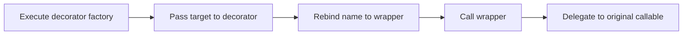

> **Level 2: Intermediate** · Topic 12 of 35

[← Generators](./11-generators.md) · [↑ Level index](../README.md) · [Context Managers →](./13-context-managers.md)

# Decorators

## Overview
- **What is it?** Decorators is the intermediate Python topic of wrapping callables or classes to add reusable behavior declaratively.
- **Why is it important?** Decorator syntax rebinds a name to the result of a transformation performed when the definition executes.
- **Where is it used?** authorization checks, instrumentation, registration and caching.

## Learning Objectives
- Translate @syntax into function application.
- Preserve wrapped metadata.
- Write parameterized and stateful decorators.

## Real World Applications
- **Engineering:** Authorization checks rely on this topic.
- **Product work:** It supports instrumentation.
- **Operations:** It appears in registration and caching.

## Core Concepts

### Callable transformation
- **Definition:** A function decorator receives a callable and returns the callable that should replace it.
- **Visual explanation:** ``@trace def f -> f = trace(f)``
- **Practical example:**

```python
def uppercase(function):
    def wrapper():
        return function().upper()
    return wrapper
```

### Closures and metadata
- **Definition:** The wrapper closes over the original callable; functools.wraps copies metadata and exposes __wrapped__.
- **Visual explanation:** ``wrapper closure -> original; wraps -> preserved identity``
- **Practical example:**

```python
from functools import wraps

def traced(function):
    @wraps(function)
    def wrapper(*args, **kwargs):
        return function(*args, **kwargs)
    return wrapper
```

### Decorator factories
- **Definition:** A parameterized decorator adds an outer factory that captures configuration before receiving the target.
- **Visual explanation:** ``@retry(3) -> factory(3) -> decorator -> wrapper``
- **Practical example:**

```python
def tagged(label):
    def decorate(function):
        function.label = label
        return function
    return decorate
```

## Infographic Summary

| Infographic Block | Topic-specific guidance |
| --- | --- |
| 📌 Concept | Callable transformation, Closures and metadata, Decorator factories |
| ⚡ Purpose | Decorator syntax rebinds a name to the result of a transformation performed when the definition executes. |
| 🔥 Benefits | Reusable cross-cutting behavior, declarative application, and consistent instrumentation or policy. |
| 🎯 Use Cases | authorization checks, instrumentation, registration and caching |
| 🚀 Best Practices | Keep wrappers transparent and use wraps unless intentionally changing the interface. |
| ❌ Common Mistakes | Performing request-time work when the decorated function is defined. |

## Syntax Guide

### Basic Syntax

```python
def announce(function):
    def wrapper(*args, **kwargs):
        print(function.__name__)
        return function(*args, **kwargs)
    return wrapper
```

### Standard Structure

```python
from functools import wraps

def require_nonempty(function):
    @wraps(function)
    def wrapper(value, *args, **kwargs):
        if not value:
            raise ValueError("value is required")
        return function(value, *args, **kwargs)
    return wrapper
```

### Code Pattern

```python
# Factory captures decorator arguments (optional).
# Decorator receives the target.
# Wrapper runs before/after behavior.
# functools.wraps preserves target metadata.
```

## Examples

### Beginner Example

```python
def excited(function):
    def wrapper(name):
        return function(name) + "!"
    return wrapper

@excited
def greet(name):
    return f"Hello, {name}"

print(greet("Ada"))
```

### Intermediate Example

```python
from functools import wraps
from time import perf_counter

def timed(function):
    @wraps(function)
    def wrapper(*args, **kwargs):
        started = perf_counter()
        try:
            return function(*args, **kwargs)
        finally:
            print(f"{function.__name__}: {perf_counter() - started:.6f}s")
    return wrapper

@timed
def total(values):
    return sum(values)

print(total(range(1000)))
```

### Advanced Example

```python
from functools import wraps

def retry(attempts: int, exceptions=(Exception,)):
    if attempts < 1:
        raise ValueError("attempts must be positive")

    def decorate(function):
        @wraps(function)
        def wrapper(*args, **kwargs):
            for attempt in range(1, attempts + 1):
                try:
                    return function(*args, **kwargs)
                except exceptions:
                    if attempt == attempts:
                        raise
        return wrapper
    return decorate

@retry(3, (ConnectionError,))
def connect():
    return "connected"

print(connect())
```

## Workflow Diagram



---

[← Generators](./11-generators.md) · [↑ Level index](../README.md) · [Context Managers →](./13-context-managers.md)
