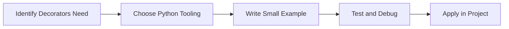

> **Level 2: Intermediate** · Topic 12 of 35

[← Generators](./11-generators.md) · [↑ Level index](../README.md) · [Context Managers →](./13-context-managers.md)

# Decorators

## Overview
- **What is it?** Decorators is a Python knowledge area focused on professional Python patterns.
- **Why is it important?** Help developers apply professional Python patterns techniques safely, clearly, and consistently.
- **Where is it used?** Data exchange, observability, clean abstractions, and production utilities.

## Learning Objectives
- Gain the practical skill to explain, write, debug, and review decorators code.
- Cover the vocabulary, syntax, workflow, edge cases, and professional habits behind decorators.
- Expected outcome: you can use decorators in a small project and recognize when it belongs in production code.

## Real World Applications
- **Industry use cases:** Data exchange, observability, clean abstractions, and production utilities.
- **Business applications:** Reduce manual work, improve reliability, support reporting, automate decisions, and ship maintainable features.
- **Career relevance:** Supports Python developer, backend engineer, data engineer, AI engineer, DevOps engineer, QA automation, and cybersecurity automation roles.

## Core Concepts

### Mental Model
- **Definition:** The main idea that gives decorators its structure and purpose inside a Python program.
- **Visual explanation:** `problem -> Decorators model -> clear code`
- **Practical example:**

```python
apply_decorators_label = "Decorators"
print(apply_decorators_label)
```

### Execution Flow
- **Definition:** The ordered steps Python follows when decorators code is created, executed, or integrated.
- **Visual explanation:** `input -> Python operation -> result -> feedback`
- **Practical example:**

```python
def uppercase(func):
    def wrapper():
        return func().upper()
    return wrapper

@uppercase
def message():
    return "hello"

print(message())
```

### Quality Rule
- **Definition:** The reliability habit that keeps decorators understandable, testable, secure, and maintainable.
- **Visual explanation:** `working code -> validation -> production confidence`
- **Practical example:**

```python
import time

def timer(func):
    def wrapper(*args, **kwargs):
        start = time.perf_counter()
        result = func(*args, **kwargs)
        print(round(time.perf_counter() - start, 6))
        return result
    return wrapper

@timer
def work():
    return sum(range(1000))

print(work())
```

## Infographic Summary

| Infographic Block | Key Message |
| --- | --- |
| 📌 Concept | Decorators belongs to the professional Python patterns part of Python mastery. |
| ⚡ Purpose | Help developers apply professional Python patterns techniques safely, clearly, and consistently. |
| 🔥 Benefits | Stronger maintainability, better reliability, and more professional professional Python patterns decisions. |
| 🎯 Use Cases | Data exchange, observability, clean abstractions, and production utilities. |
| 🚀 Best Practices | Prefer readable names, small examples, explicit errors, tests, documentation, and version-aware choices. |
| ❌ Common Mistakes | Copying code without understanding it, ignoring edge cases, skipping validation, and mixing unrelated responsibilities. |

## Syntax Guide

### Basic Syntax

```python
def decorator(func):
    def wrapper(*args, **kwargs):
        return func(*args, **kwargs)
    return wrapper
```

### Standard Structure

```python
def apply_decorators(value):
    """Apply the Decorators concept to one value."""
    return value

result = apply_decorators("practice")
print(result)
```

### Code Pattern

```python
# 1. Identify the Decorators problem
# 2. Apply the correct Python structure
# 3. Validate the result with tests or output
```

## Examples

### Beginner Example

```python
def uppercase(func):
    def wrapper():
        return func().upper()
    return wrapper

@uppercase
def message():
    return "hello"

print(message())
```

### Intermediate Example

```python
import time

def timer(func):
    def wrapper(*args, **kwargs):
        start = time.perf_counter()
        result = func(*args, **kwargs)
        print(round(time.perf_counter() - start, 6))
        return result
    return wrapper

@timer
def work():
    return sum(range(1000))

print(work())
```

### Advanced Example

```python
from functools import wraps

def require_role(role: str):
    def outer(func):
        @wraps(func)
        def inner(user, *args, **kwargs):
            if user.get("role") != role:
                raise PermissionError(role)
            return func(user, *args, **kwargs)
        return inner
    return outer

@require_role("admin")
def delete_user(user):
    return "deleted"

print(delete_user({"role": "admin"}))
```

## Workflow Diagram




---

---

[← Generators](./11-generators.md) · [↑ Level index](../README.md) · [Context Managers →](./13-context-managers.md)
