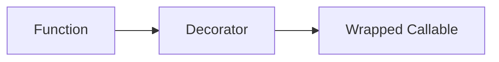

# Decorators

## Overview

- **What is it?** Decorators wrap functions or classes to extend behavior without modifying their source.
- **Why is it important?** Cross-cutting concerns like logging, timing, auth belong in decorators.
- **Where is it used?** Web frameworks, CLI, testing, caching layers.

## Learning Objectives

- **Skills gained:** Practical command of Decorators.
- **Concepts covered:**

- Write function decorators with functools.wraps.
- Create parameterized decorators.
- Stack decorators safely.

- **Expected outcome:** You add reusable behavior around callables cleanly.

## Real World Applications

- Web APIs
- Auth middleware
- Performance tooling
- Feature flags

- **Business applications:** Automate workflows, reduce manual errors, accelerate delivery.
- **Career relevance:** Required knowledge for Python roles from junior developer to senior engineer.

## Core Concepts

### @syntax

- **Definition:** Syntactic sugar for wrapping.
- **Visual explanation:** `@syntax` → process → result
- **Practical example:**

```python
def deco(f):
    def wrap(*a, **k):
        return f(*a, **k)
    return wrap
@deco
def hi():
    return 'hi'
print(hi())
```

### wraps

- **Definition:** Preserve metadata.
- **Visual explanation:** `wraps` → process → result
- **Practical example:**

```python
from functools import wraps
def deco(f):
    @wraps(f)
    def wrap():
        return f()
    return wrap
@deco
def work():
    'doc'
    return 1
print(work.__name__)
```

### Param decorator

- **Definition:** Decorator factory.
- **Visual explanation:** `Param decorator` → process → result
- **Practical example:**

```python
def repeat(n):
    def deco(f):
        def wrap():
            return [f() for _ in range(n)]
        return wrap
    return deco
@repeat(2)
def one():
    return 1
print(one())
```

## Infographic Summary

| Block | Summary |
| --- | --- |
| 📌 Concept | Decorators are higher-order functions applying wrappers. |
| ⚡ Purpose | Inject before/after logic around callables. |
| 🔥 Benefits | DRY, composable, framework-friendly. |
| 🎯 Use Cases | Timing, retries, access control, memoization. |
| 🚀 Best Practices | Use wraps; keep wrappers thin; type the wrapped callable. |
| ❌ Common Mistakes | Forgetting wraps, decorator order confusion, heavy work at import. |

## Syntax Guide

### Basic Syntax

```python
def logged(func):
    def wrapper(*args, **kwargs):
        print('call', func.__name__)
        return func(*args, **kwargs)
    return wrapper
```

### Standard Structure

```python
define wrapper -> apply with @ -> preserve metadata
```

### Code Pattern

```python
def view():
    return 'ok'


print(view())
```

## Examples

### Beginner Example

```python
def uppercase(func):
    def wrapper(text):
        return func(text).upper()
    return wrapper

@uppercase
def greet(name):
    return f'hello {name}'

print(greet('ada'))
```

### Intermediate Example

```python
from functools import wraps


def retry(times: int):
    def decorator(func):
        @wraps(func)
        def wrapper(*args, **kwargs):
            last = None
            for _ in range(times):
                try:
                    return func(*args, **kwargs)
                except Exception as exc:
                    last = exc
            raise last

        return wrapper

    return decorator


@retry(3)
def flaky():
    return 'ok'


print(flaky())
```

### Advanced Example

```python
import time
from functools import wraps


def timed(func):
    @wraps(func)
    def wrapper(*args, **kwargs):
        start = time.perf_counter()
        result = func(*args, **kwargs)
        print(f'{func.__name__} took {time.perf_counter() - start:.4f}s')
        return result

    return wrapper


@timed
def compute(n: int) -> int:
    return sum(range(n))


print(compute(1000))
```

## Workflow Diagram



---
