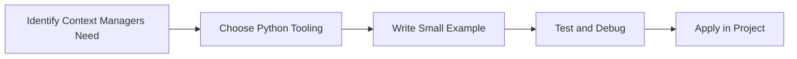

> **Level 2: Intermediate** · Topic 13 of 35

[← Decorators](./12-decorators.md) · [↑ Level index](../README.md) · [Regular Expressions →](./14-regular-expressions.md)

# Context Managers

## Overview
- **What is it?** Context Managers is a Python knowledge area focused on professional Python patterns.
- **Why is it important?** Help developers apply professional Python patterns techniques safely, clearly, and consistently.
- **Where is it used?** Data exchange, observability, clean abstractions, and production utilities.

## Learning Objectives
- Gain the practical skill to explain, write, debug, and review context managers code.
- Cover the vocabulary, syntax, workflow, edge cases, and professional habits behind context managers.
- Expected outcome: you can use context managers in a small project and recognize when it belongs in production code.

## Real World Applications
- **Industry use cases:** Data exchange, observability, clean abstractions, and production utilities.
- **Business applications:** Reduce manual work, improve reliability, support reporting, automate decisions, and ship maintainable features.
- **Career relevance:** Supports Python developer, backend engineer, data engineer, AI engineer, DevOps engineer, QA automation, and cybersecurity automation roles.

## Core Concepts

### Mental Model
- **Definition:** The main idea that gives context managers its structure and purpose inside a Python program.
- **Visual explanation:** `problem -> Context Managers model -> clear code`
- **Practical example:**

```python
apply_context_managers_label = "Context Managers"
print(apply_context_managers_label)
```

### Execution Flow
- **Definition:** The ordered steps Python follows when context managers code is created, executed, or integrated.
- **Visual explanation:** `input -> Python operation -> result -> feedback`
- **Practical example:**

```python
from pathlib import Path

with Path("note.txt").open("w", encoding="utf-8") as file:
    file.write("safe write")
```

### Quality Rule
- **Definition:** The reliability habit that keeps context managers understandable, testable, secure, and maintainable.
- **Visual explanation:** `working code -> validation -> production confidence`
- **Practical example:**

```python
from contextlib import contextmanager

@contextmanager
def managed_resource():
    print("open")
    try:
        yield "resource"
    finally:
        print("close")

with managed_resource() as resource:
    print(resource)
```

## Infographic Summary

| Infographic Block | Key Message |
| --- | --- |
| 📌 Concept | Context Managers belongs to the professional Python patterns part of Python mastery. |
| ⚡ Purpose | Help developers apply professional Python patterns techniques safely, clearly, and consistently. |
| 🔥 Benefits | Stronger maintainability, better reliability, and more professional professional Python patterns decisions. |
| 🎯 Use Cases | Data exchange, observability, clean abstractions, and production utilities. |
| 🚀 Best Practices | Prefer readable names, small examples, explicit errors, tests, documentation, and version-aware choices. |
| ❌ Common Mistakes | Copying code without understanding it, ignoring edge cases, skipping validation, and mixing unrelated responsibilities. |

## Syntax Guide

### Basic Syntax

```python
with open("file.txt", "w", encoding="utf-8") as file:
    file.write("data")
```

### Standard Structure

```python
def apply_context_managers(value):
    """Apply the Context Managers concept to one value."""
    return value

result = apply_context_managers("practice")
print(result)
```

### Code Pattern

```python
# 1. Identify the Context Managers problem
# 2. Apply the correct Python structure
# 3. Validate the result with tests or output
```

## Examples

### Beginner Example

```python
from pathlib import Path

with Path("note.txt").open("w", encoding="utf-8") as file:
    file.write("safe write")
```

### Intermediate Example

```python
from contextlib import contextmanager

@contextmanager
def managed_resource():
    print("open")
    try:
        yield "resource"
    finally:
        print("close")

with managed_resource() as resource:
    print(resource)
```

### Advanced Example

```python
from contextlib import ExitStack
from pathlib import Path

paths = [Path("a.txt"), Path("b.txt")]
with ExitStack() as stack:
    files = [stack.enter_context(path.open("w", encoding="utf-8")) for path in paths]
    for file in files:
        file.write("ok")
```

## Workflow Diagram




---

---

[← Decorators](./12-decorators.md) · [↑ Level index](../README.md) · [Regular Expressions →](./14-regular-expressions.md)
