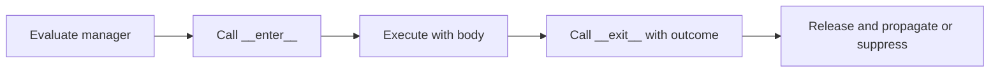

> **Level 2: Intermediate** · Topic 13 of 35

[← Decorators](./12-decorators.md) · [↑ Level index](../README.md) · [Regular Expressions →](./14-regular-expressions.md)

# Context Managers

## Overview
- **What is it?** Context managers pair resource acquisition with reliable cleanup around a with block via __enter__/__exit__ or contextlib.
- **Why is it important?** They guarantee cleanup on success and failure, preventing leaks of files, locks, connections, and transactions.
- **Where is it used?** Files, database sessions, locks, temporary directories, and transactional units of work.

## Learning Objectives
- Implement __enter__ and __exit__.
- Use contextlib.contextmanager.
- Decide whether an exception should be suppressed.

## Real World Applications
- Always close files and sockets even when exceptions occur.
- Commit or roll back database transactions consistently.
- Hold concurrency locks for the smallest correct critical section.

## Core Concepts

### Context protocol
- **Definition:** __enter__ produces the bound value and __exit__ receives exception details while releasing resources.
- **Visual explanation:** ``with -> __enter__ -> body -> __exit__``
- **Practical example:**

```python
with open("notes.txt", "w", encoding="utf-8") as handle:
    handle.write("safe cleanup")
```

### Exception handling
- **Definition:** __exit__ returning truthy suppresses the active exception; returning falsey propagates it after cleanup.
- **Visual explanation:** ``body error -> __exit__(type, value, traceback) -> suppress or raise``
- **Practical example:**

```python
class VisibleErrors:
    def __enter__(self):
        return self
    def __exit__(self, exc_type, exc, tb):
        return False
```

### Generator-based managers
- **Definition:** contextmanager turns a one-yield generator into setup before yield and cleanup in finally.
- **Visual explanation:** ``setup -> yield resource -> finally cleanup``
- **Practical example:**

```python
from contextlib import contextmanager

@contextmanager
def managed():
    try:
        yield "resource"
    finally:
        pass
```

## Infographic Summary

| Infographic Block | Topic-specific guidance |
| --- | --- |
| 📌 Concept | Context managers pair resource acquisition with reliable cleanup around a with block via __enter__/__exit__ or contextlib. |
| ⚡ Purpose | The context manager protocol guarantees __exit__ runs when control leaves the block, including through exceptions. |
| 🔥 Benefits | Guaranteed cleanup, concise resource lifetimes, and reliable transaction or temporary-state handling. |
| 🎯 Use Cases | files and locks, database transactions, temporary state |
| 🚀 Best Practices | Keep acquisition and release adjacent and make cleanup idempotent where possible. |
| ❌ Common Mistakes | Returning True from __exit__ accidentally and hiding real failures. |

## Syntax Guide

### Basic Syntax

```python
with open("report.txt", "w", encoding="utf-8") as file:
    file.write("complete")
```

### Standard Structure

```python
from contextlib import contextmanager

@contextmanager
def transaction(connection):
    try:
        yield connection
        connection.commit()
    except Exception:
        connection.rollback()
        raise
```

### Code Pattern

```python
# __enter__: acquire and return resource
# with body: use resource
# __exit__: release in every exit path
# False return: propagate active exception
```

## Examples

### Beginner Example

```python
from io import StringIO

with StringIO() as buffer:
    buffer.write("context-managed")
    print(buffer.getvalue())
```

### Intermediate Example

```python
class TemporarySetting:
    def __init__(self, settings, key, value):
        self.settings, self.key, self.value = settings, key, value

    def __enter__(self):
        self.previous = self.settings.get(self.key)
        self.settings[self.key] = self.value
        return self.settings

    def __exit__(self, exc_type, exc, traceback):
        if self.previous is None:
            self.settings.pop(self.key, None)
        else:
            self.settings[self.key] = self.previous
        return False

settings = {"mode": "normal"}
with TemporarySetting(settings, "mode", "debug"):
    print(settings)
print(settings)
```

### Advanced Example

```python
from contextlib import ExitStack, contextmanager

@contextmanager
def resource(name):
    print("open", name)
    try:
        yield name
    finally:
        print("close", name)

names = ["input", "output", "audit"]
with ExitStack() as stack:
    opened = [stack.enter_context(resource(name)) for name in names]
    print("using", opened)
```

## Workflow Diagram



---

[← Decorators](./12-decorators.md) · [↑ Level index](../README.md) · [Regular Expressions →](./14-regular-expressions.md)
