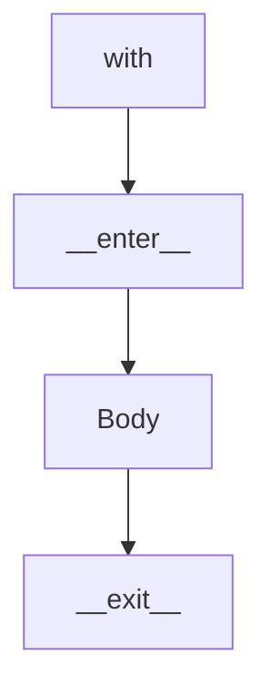

# Context Managers

## Overview

- **What is it?** Context managers setup and teardown resources with the with statement.
- **Why is it important?** Guaranteed cleanup prevents leaks even when errors occur.
- **Where is it used?** Files, locks, DB transactions, temporary directories.

## Learning Objectives

- **Skills gained:** Practical command of Context Managers.
- **Concepts covered:**

- Use with for files and locks.
- Implement __enter__/__exit__.
- Use contextlib.contextmanager.

- **Expected outcome:** You manage resources safely with with blocks.

## Real World Applications

- Database apps
- Concurrent services
- Infra automation
- Desktop apps

- **Business applications:** Automate workflows, reduce manual errors, accelerate delivery.
- **Career relevance:** Required knowledge for Python roles from junior developer to senior engineer.

## Core Concepts

### with

- **Definition:** Calls __enter__ and __exit__.
- **Visual explanation:** `with` → process → result
- **Practical example:**

```python
from contextlib import contextmanager
@contextmanager
def tag(name):
    print(f'<{name}>')
    yield
    print(f'</{name}>')
with tag('p'):
    print('hi')
```

### __exit__

- **Definition:** Receives exception info.
- **Visual explanation:** `__exit__` → process → result
- **Practical example:**

```python
class Demo:
    def __enter__(self):
        return self
    def __exit__(self, exc_type, exc, tb):
        print('cleanup', exc_type is None)
        return False
with Demo():
    pass
```

### contextmanager

- **Definition:** Generator-based manager.
- **Visual explanation:** `contextmanager` → process → result
- **Practical example:**

```python
from contextlib import contextmanager
@contextmanager
def opened(path):
    f = open(path, encoding='utf-8')
    try:
        yield f
    finally:
        f.close()
with opened('README.md') as fh:
    print(fh.readline()[:5])
```

## Infographic Summary

| Block | Summary |
| --- | --- |
| 📌 Concept | Context managers pair acquisition with release. |
| ⚡ Purpose | Deterministic setup/teardown. |
| 🔥 Benefits | Exception-safe cleanup, readable scope. |
| 🎯 Use Cases | Transactions, temp dirs, timing blocks. |
| 🚀 Best Practices | Avoid suppressing exceptions unless intended; keep __exit__ fast. |
| ❌ Common Mistakes | Manual open/close, swallowing errors, re-entrant locks misuse. |

## Syntax Guide

### Basic Syntax

```python
with open('file.txt', encoding='utf-8') as f:
    data = f.read()
```

### Standard Structure

```python
__enter__ -> body -> __exit__
```

### Code Pattern

```python
with lock:
    mutate_shared_state()
```

## Examples

### Beginner Example

```python
from contextlib import suppress
with suppress(ValueError):
    int('x')
print('ok')
```

### Intermediate Example

```python
from contextlib import contextmanager


@contextmanager
def temporary(value: str):
    print('set', value)
    try:
        yield value
    finally:
        print('unset', value)


with temporary('config') as cfg:
    print('use', cfg)
```

### Advanced Example

```python
import threading


class LockGuard:
    def __init__(self, lock: threading.Lock):
        self.lock = lock

    def __enter__(self):
        self.lock.acquire()
        return self

    def __exit__(self, exc_type, exc, tb):
        self.lock.release()
        return False


lock = threading.Lock()
with LockGuard(lock):
    print('critical section')
```

## Workflow Diagram



---
