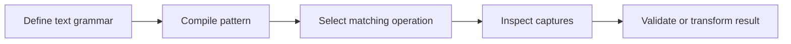

> **Level 2: Intermediate** · Topic 14 of 35

[← Context Managers](./13-context-managers.md) · [↑ Level index](../README.md) · [JSON Processing →](./15-json-processing.md)

# Regular Expressions

## Overview
- **What is it?** Regular expressions describe text patterns used to search, validate, extract, and rewrite strings.
- **Why is it important?** They compactly express structured text rules that would be brittle as hand-written loops.
- **Where is it used?** Log parsing, form validation, scraping cleanup, token extraction, and configuration linting.

## Learning Objectives
- Use raw strings, groups, and quantifiers.
- Choose match, search, fullmatch, and finditer.
- Control backtracking with precise patterns.

## Real World Applications
- Extract IPs, emails, or order IDs from unstructured logs.
- Validate user input formats before persistence.
- Normalize scraped HTML text into structured fields.

## Core Concepts

### Pattern language
- **Definition:** A regex combines literals, character classes, quantifiers, and anchors to describe matching text.
- **Visual explanation:** ``text -> pattern engine -> match spans``
- **Practical example:**

```python
import re
print(bool(re.fullmatch(r"[A-Z]{2}-\d{4}", "GB-2048")))
```

### Groups and captures
- **Definition:** Parentheses group expressions; named capturing groups expose meaningful substrings through a Match object.
- **Visual explanation:** ``(?P<name>...) -> match.group('name')``
- **Practical example:**

```python
import re
match = re.search(r"order=(?P<id>\d+)", "order=42")
print(match.group("id") if match else None)
```

### Compilation and boundaries
- **Definition:** Compiled patterns reuse intent and flags; anchors or fullmatch prevent accepting an unintended substring.
- **Visual explanation:** ``compile once -> fullmatch many inputs``
- **Practical example:**

```python
import re
slug = re.compile(r"[a-z0-9]+(?:-[a-z0-9]+)*")
print(bool(slug.fullmatch("python-patterns")))
```

## Infographic Summary

| Infographic Block | Topic-specific guidance |
| --- | --- |
| 📌 Concept | Regular expressions describe text patterns used to search, validate, extract, and rewrite strings. |
| ⚡ Purpose | Regex is effective for local text grammars but should not replace a parser for deeply nested formats. |
| 🔥 Benefits | Concise text validation, structured capture, and repeatable search or redaction rules. |
| 🎯 Use Cases | input validation, log extraction, search and redaction |
| 🚀 Best Practices | Use raw string literals and test valid, invalid, and adversarial inputs. |
| ❌ Common Mistakes | Using .* greedily when a bounded character class expresses the grammar. |

## Syntax Guide

### Basic Syntax

```python
import re
match = re.search(r"\d+", "invoice 204")
if match:
    print(match.group())
```

### Standard Structure

```python
import re

DATE = re.compile(
    r"(?P<year>\d{4})-(?P<month>0[1-9]|1[0-2])-(?P<day>\d{2})"
)
match = DATE.fullmatch("2026-07-20")
```

### Code Pattern

```python
# Define the accepted text grammar.
# Anchor the match to the required boundary.
# Capture only fields the program needs.
# Handle the possibility of no match.
```

## Examples

### Beginner Example

```python
import re

words = re.findall(r"\bpy\w*", "Python powers pytests and pydantic", re.IGNORECASE)
print(words)
```

### Intermediate Example

```python
import re

LOG_LINE = re.compile(
    r"^(?P<level>INFO|WARN|ERROR) "
    r"(?P<code>[A-Z]\d{3}) "
    r"(?P<message>.+)$"
)
match = LOG_LINE.fullmatch("ERROR E503 service unavailable")
if match:
    print(match.groupdict())
```

### Advanced Example

```python
import re

SECRET = re.compile(
    r"(?P<prefix>api[_-]?key\s*[=:]\s*)"
    r"(?P<value>[A-Za-z0-9_-]{8,})",
    re.IGNORECASE,
)

def redact(text: str) -> str:
    return SECRET.sub(lambda match: match["prefix"] + "***", text)

line = "user=ada api_key=abcDEF123456 status=ok"
print(redact(line))
print([(m.start(), m.group("value")) for m in SECRET.finditer(line)])
```

## Workflow Diagram



---

[← Context Managers](./13-context-managers.md) · [↑ Level index](../README.md) · [JSON Processing →](./15-json-processing.md)
