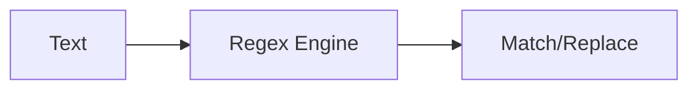

# Regular Expressions

## Overview

- **What is it?** Regular expressions match and manipulate text via pattern rules.
- **Why is it important?** They extract, validate, and replace structured text efficiently.
- **Where is it used?** Log parsing, input validation, web scraping, data cleaning.

## Learning Objectives

- **Skills gained:** Practical command of Regular Expressions.
- **Concepts covered:**

- Use re.search, re.findall, re.sub.
- Read basic regex syntax.
- Prefer compiled patterns for reuse.

- **Expected outcome:** You solve text pattern tasks without fragile manual parsing.

## Real World Applications

- Security analytics
- SEO tools
- Support automation
- Compliance scanning

- **Business applications:** Automate workflows, reduce manual errors, accelerate delivery.
- **Career relevance:** Required knowledge for Python roles from junior developer to senior engineer.

## Core Concepts

### re.search

- **Definition:** Find first match.
- **Visual explanation:** `re.search` → process → result
- **Practical example:**

```python
import re
print(re.search(r'\d+', 'Room 42').group())
```

### groups

- **Definition:** Capture subpatterns.
- **Visual explanation:** `groups` → process → result
- **Practical example:**

```python
import re
m = re.match(r'(?P<user>\w+)@(?P<dom>\w+)', 'ada@example.com')
print(m.group('user'))
```

### re.sub

- **Definition:** Replace matches.
- **Visual explanation:** `re.sub` → process → result
- **Practical example:**

```python
import re
print(re.sub(r'\s+', '-', 'hello world'))
```

## Infographic Summary

| Block | Summary |
| --- | --- |
| 📌 Concept | Regex engines match patterns over strings. |
| ⚡ Purpose | Parse semi-structured text reliably. |
| 🔥 Benefits | Powerful, compact, standard library support. |
| 🎯 Use Cases | Emails, IPs, URLs, log levels. |
| 🚀 Best Practices | Compile patterns; use raw strings; test edge cases. |
| ❌ Common Mistakes | Catastrophic backtracking, over-regex, not anchoring when needed. |

## Syntax Guide

### Basic Syntax

```python
import re
re.findall(r'\w+', 'Hello World')
```

### Standard Structure

```python
compile -> search/match -> group/sub
```

### Code Pattern

```python
import re
PATTERN = re.compile(r'\d+')
print(PATTERN.findall('a1b22'))
```

## Examples

### Beginner Example

```python
import re
print(bool(re.fullmatch(r'\d{3}-\d{4}', '555-1234')))
```

### Intermediate Example

```python
import re

LOG = re.compile(r'(?P<level>\w+) (?P<msg>.+)')
line = 'ERROR disk full'
match = LOG.match(line)
print(match.groupdict())
```

### Advanced Example

```python
import re

def redact(text: str) -> str:
    return re.sub(r'\b\d{4}-\d{4}-\d{4}-\d{4}\b', '[CARD]', text)


print(redact('paid 4111-1111-1111-1111'))
```

## Workflow Diagram



---
