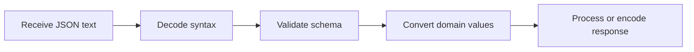

> **Level 2: Intermediate** · Topic 15 of 35

[← Regular Expressions](./14-regular-expressions.md) · [↑ Level index](../README.md) · [CSV Processing →](./16-csv-processing.md)

# JSON Processing

## Overview
- **What is it?** JSON processing encodes and decodes interoperable JSON documents for storage and network exchange.
- **Why is it important?** JSON is the default interchange format for APIs, configs, and many data pipelines.
- **Where is it used?** REST APIs, webhooks, config files, message queues, and browser/server communication.

## Learning Objectives
- Use loads/dumps and load/dump.
- Validate decoded structures.
- Customize encoding without losing type intent.

## Real World Applications
- Serialize domain objects for API responses.
- Persist settings and feature flags as readable JSON files.
- Parse webhook payloads safely with schema validation.

## Core Concepts

### JSON data model
- **Definition:** JSON supports objects, arrays, strings, numbers, booleans, and null, mapped to Python dict, list, str, numeric, bool, and None.
- **Visual explanation:** ``JSON text <-> Python primitive graph``
- **Practical example:**

```python
import json
payload = json.loads('{"active": true}')
print(payload["active"])
```

### Serialization
- **Definition:** Serialization encodes Python-compatible values to text; ensure_ascii, indent, and separators control representation.
- **Visual explanation:** ``Python values -> json.dumps -> UTF-8 text``
- **Practical example:**

```python
import json
print(json.dumps({"name": "Zoë"}, ensure_ascii=False))
```

### Validation and customization
- **Definition:** Decoding proves only valid JSON syntax; code must validate required keys and convert domain-specific values.
- **Visual explanation:** ``decode -> shape validation -> domain conversion``
- **Practical example:**

```python
import json
data = json.loads('{"quantity": 2}')
if not isinstance(data.get("quantity"), int):
    raise ValueError("integer quantity required")
```

## Infographic Summary

| Infographic Block | Topic-specific guidance |
| --- | --- |
| 📌 Concept | JSON processing encodes and decodes interoperable JSON documents for storage and network exchange. |
| ⚡ Purpose | JSON maps to a limited data model, so applications must validate shape and explicitly adapt dates, decimals, and custom objects. |
| 🔥 Benefits | Interoperable payloads, explicit data validation, and controlled domain-type conversion. |
| 🎯 Use Cases | API payloads, configuration files, event messages |
| 🚀 Best Practices | Treat decoded JSON as untrusted input and validate its structure before use. |
| ❌ Common Mistakes | Assuming every Python object can be serialized losslessly. |

## Syntax Guide

### Basic Syntax

```python
import json

text = json.dumps({"status": "ok", "count": 2})
data = json.loads(text)
```

### Standard Structure

```python
import json
from pathlib import Path

path = Path("settings.json")
with path.open("r", encoding="utf-8") as file:
    settings = json.load(file)
```

### Code Pattern

```python
# Read bytes as text with a known encoding.
# Decode JSON syntax.
# Validate keys, types, and ranges.
# Convert to domain objects before business logic.
```

## Examples

### Beginner Example

```python
import json

record = {"name": "Ada", "skills": ["Python", "SQL"], "active": True}
encoded = json.dumps(record, indent=2, sort_keys=True)
print(encoded)
print(json.loads(encoded)["skills"][0])
```

### Intermediate Example

```python
import json

def parse_job(text: str) -> tuple[str, int]:
    data = json.loads(text)
    if set(data) != {"task", "priority"}:
        raise ValueError("unexpected job fields")
    if not isinstance(data["task"], str) or not isinstance(data["priority"], int):
        raise TypeError("invalid job field type")
    if not 1 <= data["priority"] <= 5:
        raise ValueError("priority out of range")
    return data["task"], data["priority"]

print(parse_job('{"task": "index", "priority": 3}'))
```

### Advanced Example

```python
import json
from dataclasses import asdict, dataclass
from datetime import datetime, timezone

@dataclass(frozen=True)
class Event:
    name: str
    occurred_at: datetime

class EventEncoder(json.JSONEncoder):
    def default(self, value):
        if isinstance(value, datetime):
            return value.isoformat()
        if isinstance(value, Event):
            return asdict(value)
        return super().default(value)

event = Event("deployed", datetime(2026, 7, 20, tzinfo=timezone.utc))
text = json.dumps(event, cls=EventEncoder)
print(text)
```

## Workflow Diagram



---

[← Regular Expressions](./14-regular-expressions.md) · [↑ Level index](../README.md) · [CSV Processing →](./16-csv-processing.md)
