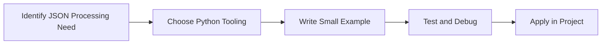

> **Level 2: Intermediate** · Topic 15 of 35

[← Regular Expressions](./14-regular-expressions.md) · [↑ Level index](../README.md) · [CSV Processing →](./16-csv-processing.md)

# JSON Processing

## Overview
- **What is it?** JSON Processing is a Python knowledge area focused on professional Python patterns.
- **Why is it important?** Help developers apply professional Python patterns techniques safely, clearly, and consistently.
- **Where is it used?** Data exchange, observability, clean abstractions, and production utilities.

## Learning Objectives
- Gain the practical skill to explain, write, debug, and review json processing code.
- Cover the vocabulary, syntax, workflow, edge cases, and professional habits behind json processing.
- Expected outcome: you can use json processing in a small project and recognize when it belongs in production code.

## Real World Applications
- **Industry use cases:** Data exchange, observability, clean abstractions, and production utilities.
- **Business applications:** Reduce manual work, improve reliability, support reporting, automate decisions, and ship maintainable features.
- **Career relevance:** Supports Python developer, backend engineer, data engineer, AI engineer, DevOps engineer, QA automation, and cybersecurity automation roles.

## Core Concepts

### Task Unit
- **Definition:** The main idea that gives json processing its structure and purpose inside a Python program.
- **Visual explanation:** `problem -> JSON Processing model -> clear code`
- **Practical example:**

```python
apply_json_processing_label = "JSON Processing"
print(apply_json_processing_label)
```

### Scheduler or Worker
- **Definition:** The ordered steps Python follows when json processing code is created, executed, or integrated.
- **Visual explanation:** `input -> Python operation -> result -> feedback`
- **Practical example:**

```python
import json
print(json.dumps({"language": "Python"}))
```

### Coordination Rule
- **Definition:** The reliability habit that keeps json processing understandable, testable, secure, and maintainable.
- **Visual explanation:** `working code -> validation -> production confidence`
- **Practical example:**

```python
import json

raw = "{\"items\": [1, 2, 3]}"
payload = json.loads(raw)
print(sum(payload["items"]))
```

## Infographic Summary

| Infographic Block | Key Message |
| --- | --- |
| 📌 Concept | JSON Processing belongs to the professional Python patterns part of Python mastery. |
| ⚡ Purpose | Help developers apply professional Python patterns techniques safely, clearly, and consistently. |
| 🔥 Benefits | Stronger maintainability, better reliability, and more professional professional Python patterns decisions. |
| 🎯 Use Cases | Data exchange, observability, clean abstractions, and production utilities. |
| 🚀 Best Practices | Prefer readable names, small examples, explicit errors, tests, documentation, and version-aware choices. |
| ❌ Common Mistakes | Copying code without understanding it, ignoring edge cases, skipping validation, and mixing unrelated responsibilities. |

## Syntax Guide

### Basic Syntax

```python
import json
data = json.loads("{\"name\": \"Ada\"}")
```

### Standard Structure

```python
def apply_json_processing(value):
    """Apply the JSON Processing concept to one value."""
    return value

result = apply_json_processing("practice")
print(result)
```

### Code Pattern

```python
# 1. Identify the JSON Processing problem
# 2. Apply the correct Python structure
# 3. Validate the result with tests or output
```

## Examples

### Beginner Example

```python
import json
print(json.dumps({"language": "Python"}))
```

### Intermediate Example

```python
import json

raw = "{\"items\": [1, 2, 3]}"
payload = json.loads(raw)
print(sum(payload["items"]))
```

### Advanced Example

```python
import json
from dataclasses import asdict, dataclass

@dataclass
class Event:
    name: str
    count: int

print(json.dumps(asdict(Event("login", 3))))
```

## Workflow Diagram




---

---

[← Regular Expressions](./14-regular-expressions.md) · [↑ Level index](../README.md) · [CSV Processing →](./16-csv-processing.md)
