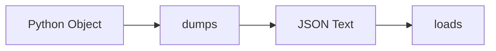

# JSON Processing

## Overview

- **What is it?** JSON processing serializes Python objects to JSON and parses JSON text.
- **Why is it important?** JSON is the lingua franca of web APIs and config files.
- **Where is it used?** REST APIs, NoSQL docs, CLI configs, message queues.

## Learning Objectives

- **Skills gained:** Practical command of JSON Processing.
- **Concepts covered:**

- Use json.dumps and json.loads.
- Handle custom types with default=.
- Validate payloads before use.

- **Expected outcome:** You exchange structured data with JSON safely.

## Real World Applications

- Microservices
- Mobile backends
- Serverless
- Browser apps

- **Business applications:** Automate workflows, reduce manual errors, accelerate delivery.
- **Career relevance:** Required knowledge for Python roles from junior developer to senior engineer.

## Core Concepts

### dumps

- **Definition:** Python to JSON string.
- **Visual explanation:** `dumps` → process → result
- **Practical example:**

```python
import json
print(json.dumps({'a': 1}))
```

### loads

- **Definition:** JSON string to Python.
- **Visual explanation:** `loads` → process → result
- **Practical example:**

```python
import json
print(json.loads('{"a": 1}')['a'])
```

### indent

- **Definition:** Pretty-print JSON.
- **Visual explanation:** `indent` → process → result
- **Practical example:**

```python
import json
print(json.dumps([1, 2], indent=2))
```

## Infographic Summary

| Block | Summary |
| --- | --- |
| 📌 Concept | JSON maps to dict/list/str/number/bool/null. |
| ⚡ Purpose | Interoperable data exchange. |
| 🔥 Benefits | Human-readable, universal, stdlib support. |
| 🎯 Use Cases | API bodies, config, event logs. |
| 🚀 Best Practices | UTF-8 encoding; schema validation at boundaries. |
| ❌ Common Mistakes | Non-JSON types without default, float money, trusting input. |

## Syntax Guide

### Basic Syntax

```python
import json
json.loads('{"ok": true}')
```

### Standard Structure

```python
parse -> validate -> use -> serialize
```

### Code Pattern

```python
payload = json.loads(text)
response = json.dumps(result)
```

## Examples

### Beginner Example

```python
import json
data = {'name': 'Ada', 'score': 99}
print(json.dumps(data))
```

### Intermediate Example

```python
import json
from datetime import datetime


def default(obj):
    if isinstance(obj, datetime):
        return obj.isoformat()
    raise TypeError(type(obj))


print(json.dumps({'at': datetime(2026, 1, 1)}, default=default))
```

### Advanced Example

```python
import json

class UserEncoder(json.JSONEncoder):
    def default(self, obj):
        if hasattr(obj, 'to_json'):
            return obj.to_json()
        return super().default(obj)


class User:
    def __init__(self, name: str):
        self.name = name

    def to_json(self):
        return {'name': self.name}


print(json.dumps(User('Ada'), cls=UserEncoder))
```

## Workflow Diagram



---
