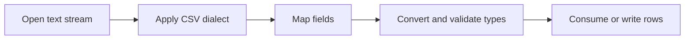

> **Level 2: Intermediate** · Topic 16 of 35

[← JSON Processing](./15-json-processing.md) · [↑ Level index](../README.md) · [XML Processing →](./17-xml-processing.md)

# CSV Processing

## Overview
- **What is it?** CSV processing reads and writes delimited tabular text using Python's csv module and related tools.
- **Why is it important?** CSV remains the common export format for spreadsheets, finance systems, and analytics handoffs.
- **Where is it used?** Data imports/exports, reporting, ETL staging, and spreadsheet interoperability.

## Learning Objectives
- Use reader/writer and DictReader/DictWriter.
- Open files with newline='' and explicit encoding.
- Validate rows and stream large files.

## Real World Applications
- Import supplier catalogs into inventory systems.
- Export monthly finance reports for analysts.
- Stage messy tabular data before loading a warehouse.

## Core Concepts

### CSV dialect
- **Definition:** A dialect defines delimiter, quote, escape, and line-termination rules for a tabular text format.
- **Visual explanation:** ``text + dialect -> fields and rows``
- **Practical example:**

```python
import csv
from io import StringIO
rows = list(csv.reader(StringIO('name,city\n"Ada","London"')))
print(rows)
```

### Dictionary rows
- **Definition:** DictReader maps header names to field strings; DictWriter emits columns in an explicit order.
- **Visual explanation:** ``header + row -> mapping[fieldname]``
- **Practical example:**

```python
import csv
from io import StringIO
reader = csv.DictReader(StringIO("name,score\nAda,91"))
print(next(reader)["score"])
```

### Type conversion and validation
- **Definition:** CSV has no native types, so every field starts as text and requires application-level conversion and validation.
- **Visual explanation:** ``field text -> parse -> validate -> typed record``
- **Practical example:**

```python
raw = "42"
quantity = int(raw)
if quantity < 0:
    raise ValueError("negative quantity")
```

## Infographic Summary

| Infographic Block | Topic-specific guidance |
| --- | --- |
| 📌 Concept | CSV processing reads and writes delimited tabular text using Python's csv module and related tools. |
| ⚡ Purpose | The csv module handles quoting, delimiters, and embedded newlines that manual string splitting gets wrong. |
| 🔥 Benefits | Correct quoting and delimiter handling, streaming imports, and stable tabular exchange. |
| 🎯 Use Cases | spreadsheet exchange, bulk imports, report exports |
| 🚀 Best Practices | Use newline='' for file handles and define a stable column contract. |
| ❌ Common Mistakes | Splitting lines on commas, which breaks quoted commas and newlines. |

## Syntax Guide

### Basic Syntax

```python
import csv

with open("data.csv", newline="", encoding="utf-8") as file:
    for row in csv.reader(file):
        print(row)
```

### Standard Structure

```python
import csv

with open("report.csv", "w", newline="", encoding="utf-8") as file:
    writer = csv.DictWriter(file, fieldnames=["name", "score"])
    writer.writeheader()
    writer.writerow({"name": "Ada", "score": 91})
```

### Code Pattern

```python
# Open with newline="" and explicit encoding.
# Parse according to the agreed dialect.
# Convert and validate every field.
# Report row numbers for invalid records.
```

## Examples

### Beginner Example

```python
import csv
from io import StringIO

source = StringIO('name,city\nAda,"London, UK"\n')
for row in csv.reader(source):
    print(row)
```

### Intermediate Example

```python
import csv
from io import StringIO

source = StringIO("name,score\nAda,91\nLin,84\n")
reader = csv.DictReader(source)
scores = {row["name"]: int(row["score"]) for row in reader}
print(scores)
```

### Advanced Example

```python
import csv
from dataclasses import dataclass
from io import StringIO

@dataclass(frozen=True)
class Sale:
    product: str
    quantity: int
    unit_price: float

def sales_from_csv(source):
    for line_number, row in enumerate(csv.DictReader(source), start=2):
        try:
            sale = Sale(row["product"], int(row["quantity"]), float(row["unit_price"]))
        except (KeyError, TypeError, ValueError) as error:
            raise ValueError(f"invalid row {line_number}") from error
        if sale.quantity < 0 or sale.unit_price < 0:
            raise ValueError(f"negative value on row {line_number}")
        yield sale

data = StringIO("product,quantity,unit_price\nBook,2,12.50\n")
print(list(sales_from_csv(data)))
```

## Workflow Diagram



---

[← JSON Processing](./15-json-processing.md) · [↑ Level index](../README.md) · [XML Processing →](./17-xml-processing.md)
