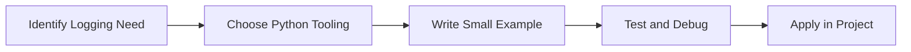

> **Level 2: Intermediate** · Topic 18 of 35

[← XML Processing](./17-xml-processing.md) · [↑ Level index](../README.md) · [Configuration Management →](./19-configuration-management.md)

# Logging

## Overview
- **What is it?** Logging is a Python knowledge area focused on professional Python patterns.
- **Why is it important?** Help developers apply professional Python patterns techniques safely, clearly, and consistently.
- **Where is it used?** Data exchange, observability, clean abstractions, and production utilities.

## Learning Objectives
- Gain the practical skill to explain, write, debug, and review logging code.
- Cover the vocabulary, syntax, workflow, edge cases, and professional habits behind logging.
- Expected outcome: you can use logging in a small project and recognize when it belongs in production code.

## Real World Applications
- **Industry use cases:** Data exchange, observability, clean abstractions, and production utilities.
- **Business applications:** Reduce manual work, improve reliability, support reporting, automate decisions, and ship maintainable features.
- **Career relevance:** Supports Python developer, backend engineer, data engineer, AI engineer, DevOps engineer, QA automation, and cybersecurity automation roles.

## Core Concepts

### Mental Model
- **Definition:** The main idea that gives logging its structure and purpose inside a Python program.
- **Visual explanation:** `problem -> Logging model -> clear code`
- **Practical example:**

```python
apply_logging_label = "Logging"
print(apply_logging_label)
```

### Execution Flow
- **Definition:** The ordered steps Python follows when logging code is created, executed, or integrated.
- **Visual explanation:** `input -> Python operation -> result -> feedback`
- **Practical example:**

```python
import logging
logging.basicConfig(level=logging.INFO)
logging.info("Hello logs")
```

### Quality Rule
- **Definition:** The reliability habit that keeps logging understandable, testable, secure, and maintainable.
- **Visual explanation:** `working code -> validation -> production confidence`
- **Practical example:**

```python
import logging

logger = logging.getLogger("billing")
logging.basicConfig(level=logging.INFO, format="%(levelname)s:%(name)s:%(message)s")
logger.info("invoice_created")
```

## Infographic Summary

| Infographic Block | Key Message |
| --- | --- |
| 📌 Concept | Logging belongs to the professional Python patterns part of Python mastery. |
| ⚡ Purpose | Help developers apply professional Python patterns techniques safely, clearly, and consistently. |
| 🔥 Benefits | Stronger maintainability, better reliability, and more professional professional Python patterns decisions. |
| 🎯 Use Cases | Data exchange, observability, clean abstractions, and production utilities. |
| 🚀 Best Practices | Prefer readable names, small examples, explicit errors, tests, documentation, and version-aware choices. |
| ❌ Common Mistakes | Copying code without understanding it, ignoring edge cases, skipping validation, and mixing unrelated responsibilities. |

## Syntax Guide

### Basic Syntax

```python
import logging
logging.info("Application started")
```

### Standard Structure

```python
def apply_logging(value):
    """Apply the Logging concept to one value."""
    return value

result = apply_logging("practice")
print(result)
```

### Code Pattern

```python
# 1. Identify the Logging problem
# 2. Apply the correct Python structure
# 3. Validate the result with tests or output
```

## Examples

### Beginner Example

```python
import logging
logging.basicConfig(level=logging.INFO)
logging.info("Hello logs")
```

### Intermediate Example

```python
import logging

logger = logging.getLogger("billing")
logging.basicConfig(level=logging.INFO, format="%(levelname)s:%(name)s:%(message)s")
logger.info("invoice_created")
```

### Advanced Example

```python
import logging

logger = logging.getLogger("api")
handler = logging.StreamHandler()
handler.setFormatter(logging.Formatter("%(asctime)s %(levelname)s %(message)s"))
logger.addHandler(handler)
logger.setLevel(logging.INFO)
logger.info("request_complete")
```

## Workflow Diagram




---

---

[← XML Processing](./17-xml-processing.md) · [↑ Level index](../README.md) · [Configuration Management →](./19-configuration-management.md)
