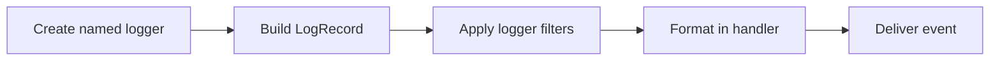

> **Level 2: Intermediate** · Topic 18 of 35

[← XML Processing](./17-xml-processing.md) · [↑ Level index](../README.md) · [Configuration Management →](./19-configuration-management.md)

# Logging

## Overview
- **What is it?** Logging is the intermediate Python topic of emitting configurable, structured runtime diagnostics.
- **Why is it important?** The logging package separates event creation from filtering, formatting, and delivery to handlers.
- **Where is it used?** service observability, incident diagnosis, audit-friendly operations.

## Learning Objectives
- Use module-level named loggers.
- Configure levels, handlers, and formatters centrally.
- Include exception and contextual information safely.

## Real World Applications
- **Engineering:** Service observability rely on this topic.
- **Product work:** It supports incident diagnosis.
- **Operations:** It appears in audit-friendly operations.

## Core Concepts

### Log records
- **Definition:** A logging call creates a LogRecord containing level, logger name, message arguments, time, and optional exception data.
- **Visual explanation:** ``logger call -> LogRecord -> handlers``
- **Practical example:**

```python
import logging
logger = logging.getLogger(__name__)
logger.info("processed %d rows", 12)
```

### Levels and filtering
- **Definition:** Logger and handler thresholds decide which records proceed; DEBUG through CRITICAL express increasing severity.
- **Visual explanation:** ``record level >= thresholds -> emit``
- **Practical example:**

```python
import logging
logging.basicConfig(level=logging.WARNING)
logging.getLogger(__name__).warning("disk nearing capacity")
```

### Handlers and formatting
- **Definition:** Handlers route records to destinations while formatters choose their textual or structured representation.
- **Visual explanation:** ``record -> console/file handler -> formatted output``
- **Practical example:**

```python
import logging
handler = logging.StreamHandler()
handler.setFormatter(logging.Formatter("%(levelname)s %(message)s"))
```

## Infographic Summary

| Infographic Block | Topic-specific guidance |
| --- | --- |
| 📌 Concept | Log records, Levels and filtering, Handlers and formatting |
| ⚡ Purpose | The logging package separates event creation from filtering, formatting, and delivery to handlers. |
| 🔥 Benefits | Configurable diagnostics, severity-based filtering, and routable operational evidence. |
| 🎯 Use Cases | service observability, incident diagnosis, audit-friendly operations |
| 🚀 Best Practices | Use lazy %-style arguments and configure logging at the application boundary. |
| ❌ Common Mistakes | Logging secrets or calling basicConfig from reusable library modules. |

## Syntax Guide

### Basic Syntax

```python
import logging

logger = logging.getLogger(__name__)
logger.warning("retrying request %s", "req-42")
```

### Standard Structure

```python
import logging

logging.basicConfig(
    level=logging.INFO,
    format="%(asctime)s %(levelname)s %(name)s %(message)s",
)
logger = logging.getLogger(__name__)
```

### Code Pattern

```python
# Module creates a named logger.
# Call emits level plus contextual arguments.
# Central configuration filters and formats.
# Handler delivers to the chosen destination.
```

## Examples

### Beginner Example

```python
import logging

logging.basicConfig(level=logging.INFO)
logger = logging.getLogger("lesson")
logger.info("lesson %s loaded", "logging")
```

### Intermediate Example

```python
import logging

logger = logging.getLogger("orders")
handler = logging.StreamHandler()
handler.setFormatter(logging.Formatter("%(levelname)s %(name)s order=%(order_id)s %(message)s"))
logger.addHandler(handler)
logger.setLevel(logging.INFO)
logger.propagate = False
logger.info("accepted", extra={"order_id": "A-17"})
```

### Advanced Example

```python
import logging
from logging.config import dictConfig

dictConfig({
    "version": 1,
    "disable_existing_loggers": False,
    "formatters": {"standard": {"format": "%(levelname)s %(name)s %(message)s"}},
    "handlers": {
        "console": {
            "class": "logging.StreamHandler",
            "formatter": "standard",
            "level": "INFO",
        }
    },
    "root": {"handlers": ["console"], "level": "INFO"},
})

logger = logging.getLogger("payments")
try:
    int("not-a-number")
except ValueError:
    logger.exception("payment amount was invalid")
```

## Workflow Diagram



---

[← XML Processing](./17-xml-processing.md) · [↑ Level index](../README.md) · [Configuration Management →](./19-configuration-management.md)
