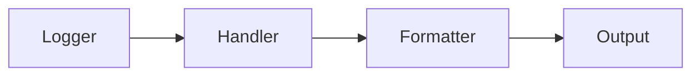

# Logging

## Overview

- **What is it?** Logging records structured runtime events with levels and handlers.
- **Why is it important?** Print statements fail in production; logs enable observability.
- **Where is it used?** Servers, batch jobs, libraries, debugging production.

## Learning Objectives

- **Skills gained:** Practical command of Logging.
- **Concepts covered:**

- Configure logging levels and handlers.
- Log with context and exceptions.
- Use module loggers.

- **Expected outcome:** You instrument apps with production-grade logs.

## Real World Applications

- SRE
- Backend platforms
- Data pipelines
- Security ops

- **Business applications:** Automate workflows, reduce manual errors, accelerate delivery.
- **Career relevance:** Required knowledge for Python roles from junior developer to senior engineer.

## Core Concepts

### getLogger

- **Definition:** Named logger hierarchy.
- **Visual explanation:** `getLogger` → process → result
- **Practical example:**

```python
import logging
log = logging.getLogger(__name__)
log.warning('warn')
```

### levels

- **Definition:** DEBUG INFO WARNING ERROR CRITICAL.
- **Visual explanation:** `levels` → process → result
- **Practical example:**

```python
import logging
print(logging.INFO)
```

### exception

- **Definition:** Log traceback.
- **Visual explanation:** `exception` → process → result
- **Practical example:**

```python
import logging
logging.basicConfig(level=logging.ERROR)
try:
    1/0
except ZeroDivisionError:
    logging.exception('fail')
```

## Infographic Summary

| Block | Summary |
| --- | --- |
| 📌 Concept | Loggers emit records processed by handlers/formatters. |
| ⚡ Purpose | Trace behavior and diagnose failures. |
| 🔥 Benefits | Levels, rotation, structured fields, filtering. |
| 🎯 Use Cases | Request tracing, audit trails, metrics hooks. |
| 🚀 Best Practices | Log to stdout in containers; include correlation ids; no secrets. |
| ❌ Common Mistakes | Root logger misconfig, logging in tight loops, sensitive data in logs. |

## Syntax Guide

### Basic Syntax

```python
import logging
logging.info('message')
```

### Standard Structure

```python
configure -> getLogger -> log events
```

### Code Pattern

```python
logger.info('user=%s action=%s', user, action)
```

## Examples

### Beginner Example

```python
import logging
logging.basicConfig(level=logging.INFO)
logging.info('started')
```

### Intermediate Example

```python
import logging

logger = logging.getLogger('billing')
logger.setLevel(logging.DEBUG)
handler = logging.StreamHandler()
handler.setFormatter(logging.Formatter('%(levelname)s %(message)s'))
logger.addHandler(handler)
logger.info('invoice created')
```

### Advanced Example

```python
import logging
from logging.handlers import RotatingFileHandler

logger = logging.getLogger('app')
handler = RotatingFileHandler('app.log', maxBytes=1024, backupCount=2)
logger.addHandler(handler)
logger.error('rotated log example')
```

## Workflow Diagram



---
