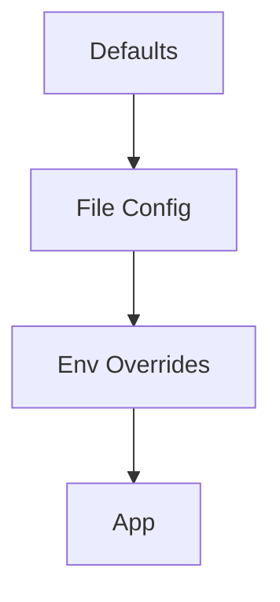

# Configuration Management

## Overview

- **What is it?** Configuration management loads settings from env vars, files, and defaults.
- **Why is it important?** Apps must behave differently per environment without code changes.
- **Where is it used?** 12-factor apps, microservices, CLI tools, notebooks.

## Learning Objectives

- **Skills gained:** Practical command of Configuration Management.
- **Concepts covered:**

- Load env with os.environ.
- Parse .env and YAML/TOML safely.
- Layer defaults < file < env.

- **Expected outcome:** You externalize settings with clear precedence rules.

## Real World Applications

- Cloud SaaS
- Kubernetes apps
- ML training jobs
- Mobile backends

- **Business applications:** Automate workflows, reduce manual errors, accelerate delivery.
- **Career relevance:** Required knowledge for Python roles from junior developer to senior engineer.

## Core Concepts

### os.environ

- **Definition:** Process environment variables.
- **Visual explanation:** `os.environ` → process → result
- **Practical example:**

```python
import os
os.environ['APP_MODE'] = 'test'
print(os.environ.get('APP_MODE'))
```

### defaults

- **Definition:** Fallback values.
- **Visual explanation:** `defaults` → process → result
- **Practical example:**

```python
import os
DEBUG = os.environ.get('DEBUG', '0') == '1'
print(DEBUG)
```

### dataclass settings

- **Definition:** Typed config object.
- **Visual explanation:** `dataclass settings` → process → result
- **Practical example:**

```python
from dataclasses import dataclass
@dataclass
class Settings:
    host: str = 'localhost'
    port: int = 8000
print(Settings().port)
```

## Infographic Summary

| Block | Summary |
| --- | --- |
| 📌 Concept | Configuration separates policy from code. |
| ⚡ Purpose | Deploy same artifact to many environments. |
| 🔥 Benefits | Security (secrets via env), flexibility, testability. |
| 🎯 Use Cases | DB URLs, API keys, feature flags. |
| 🚀 Best Practices | Never commit secrets; validate on startup; document variables. |
| ❌ Common Mistakes | Hard-coded prod URLs, silent missing env, no typing. |

## Syntax Guide

### Basic Syntax

```python
import os
API_KEY = os.environ.get('API_KEY', '')
```

### Standard Structure

```python
defaults -> file -> env overrides -> validate
```

### Code Pattern

```python
settings = Settings.from_env()
```

## Examples

### Beginner Example

```python
import os
print(os.environ.get('PATH') is not None)
```

### Intermediate Example

```python
import os
from dataclasses import dataclass


@dataclass
class Config:
    database_url: str
    debug: bool


cfg = Config(database_url=os.getenv('DATABASE_URL', 'sqlite://'), debug=os.getenv('DEBUG') == '1')
print(cfg.database_url)
```

### Advanced Example

```python
import json
from pathlib import Path


def load_settings(path: Path) -> dict:
    data = json.loads(path.read_text(encoding='utf-8'))
    data.update({k.lower(): v for k, v in __import__('os').environ.items() if k.startswith('APP_')})
    return data


print('keys' in load_settings.__name__ or callable(load_settings))
```

## Workflow Diagram



---
