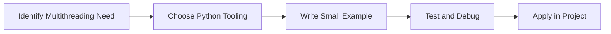

> **Level 2: Intermediate** · Topic 20 of 35

[← Configuration Management](./19-configuration-management.md) · [↑ Level index](../README.md) · [Multiprocessing →](./21-multiprocessing.md)

# Multithreading

## Overview
- **What is it?** Multithreading is a Python knowledge area focused on execution model.
- **Why is it important?** Help developers apply execution model techniques safely, clearly, and consistently.
- **Where is it used?** High-throughput services, background jobs, io workloads, and cpu-bound processing.

## Learning Objectives
- Gain the practical skill to explain, write, debug, and review multithreading code.
- Cover the vocabulary, syntax, workflow, edge cases, and professional habits behind multithreading.
- Expected outcome: you can use multithreading in a small project and recognize when it belongs in production code.

## Real World Applications
- **Industry use cases:** High-throughput services, background jobs, io workloads, and cpu-bound processing.
- **Business applications:** Reduce manual work, improve reliability, support reporting, automate decisions, and ship maintainable features.
- **Career relevance:** Supports Python developer, backend engineer, data engineer, AI engineer, DevOps engineer, QA automation, and cybersecurity automation roles.

## Core Concepts

### Task Unit
- **Definition:** The main idea that gives multithreading its structure and purpose inside a Python program.
- **Visual explanation:** `problem -> Multithreading model -> clear code`
- **Practical example:**

```python
apply_multithreading_label = "Multithreading"
print(apply_multithreading_label)
```

### Scheduler or Worker
- **Definition:** The ordered steps Python follows when multithreading code is created, executed, or integrated.
- **Visual explanation:** `input -> Python operation -> result -> feedback`
- **Practical example:**

```python
from threading import Thread

def say_hi():
    print("hi")

thread = Thread(target=say_hi)
thread.start()
thread.join()
```

### Coordination Rule
- **Definition:** The reliability habit that keeps multithreading understandable, testable, secure, and maintainable.
- **Visual explanation:** `working code -> validation -> production confidence`
- **Practical example:**

```python
from concurrent.futures import ThreadPoolExecutor

def fetch(page):
    return f"page-{page}"

with ThreadPoolExecutor(max_workers=3) as pool:
    print(list(pool.map(fetch, range(3))))
```

## Infographic Summary

| Infographic Block | Key Message |
| --- | --- |
| 📌 Concept | Multithreading belongs to the execution model part of Python mastery. |
| ⚡ Purpose | Help developers apply execution model techniques safely, clearly, and consistently. |
| 🔥 Benefits | Stronger maintainability, better reliability, and more professional execution model decisions. |
| 🎯 Use Cases | High-throughput services, background jobs, io workloads, and cpu-bound processing. |
| 🚀 Best Practices | Prefer readable names, small examples, explicit errors, tests, documentation, and version-aware choices. |
| ❌ Common Mistakes | Copying code without understanding it, ignoring edge cases, skipping validation, and mixing unrelated responsibilities. |

## Syntax Guide

### Basic Syntax

```python
from threading import Thread
thread = Thread(target=print, args=("hi",))
thread.start()
thread.join()
```

### Standard Structure

```python
def apply_multithreading(value):
    """Apply the Multithreading concept to one value."""
    return value

result = apply_multithreading("practice")
print(result)
```

### Code Pattern

```python
# 1. Identify the Multithreading problem
# 2. Apply the correct Python structure
# 3. Validate the result with tests or output
```

## Examples

### Beginner Example

```python
from threading import Thread

def say_hi():
    print("hi")

thread = Thread(target=say_hi)
thread.start()
thread.join()
```

### Intermediate Example

```python
from concurrent.futures import ThreadPoolExecutor

def fetch(page):
    return f"page-{page}"

with ThreadPoolExecutor(max_workers=3) as pool:
    print(list(pool.map(fetch, range(3))))
```

### Advanced Example

```python
from queue import Queue
from threading import Thread

queue = Queue()
queue.put("task")

def worker():
    item = queue.get()
    print(item)
    queue.task_done()

thread = Thread(target=worker)
thread.start()
queue.join()
thread.join()
```

## Workflow Diagram




---

---

[← Configuration Management](./19-configuration-management.md) · [↑ Level index](../README.md) · [Multiprocessing →](./21-multiprocessing.md)
