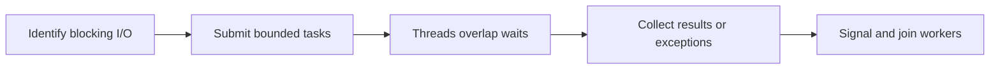

> **Level 2: Intermediate** · Topic 20 of 35

[← Configuration Management](./19-configuration-management.md) · [↑ Level index](../README.md) · [Multiprocessing →](./21-multiprocessing.md)

# Multithreading

## Overview
- **What is it?** Multithreading overlaps blocking I/O inside one process using multiple threads that share memory.
- **Why is it important?** It can improve throughput for I/O-bound work, though the GIL limits pure Python CPU parallelism.
- **Where is it used?** Network clients, UI responsiveness, concurrent downloads, and mixed I/O workloads.

## Learning Objectives
- Choose threads for blocking I/O, not CPU-heavy Python loops.
- Coordinate shared state with locks or queues.
- Shut down workers without queue.empty races.

## Real World Applications
- Download many independent URLs concurrently.
- Keep a desktop UI responsive while a worker thread processes files.
- Fan out slow third-party API calls with a bounded thread pool.

## Core Concepts

### Thread scheduling
- **Definition:** Operating-system threads share one process; while one waits on I/O another can run, despite the CPython GIL.
- **Visual explanation:** ``I/O wait T1 -> scheduler runs T2``
- **Practical example:**

```python
from threading import Thread

thread = Thread(target=print, args=("worker",))
thread.start()
thread.join()
```

### Shared-state synchronization
- **Definition:** A Lock makes a critical section mutually exclusive so compound updates are not interleaved.
- **Visual explanation:** ``threads -> lock -> protected state``
- **Practical example:**

```python
from threading import Lock
lock = Lock()
with lock:
    shared_total = 1
```

### Work queues and shutdown
- **Definition:** Queue provides synchronized handoff; sentinels or explicit task counts signal completion without unreliable empty() checks.
- **Visual explanation:** ``producer -> Queue -> workers -> sentinel -> join``
- **Practical example:**

```python
from queue import Queue
jobs = Queue()
jobs.put("task")
jobs.put(None)
```

## Infographic Summary

| Infographic Block | Topic-specific guidance |
| --- | --- |
| 📌 Concept | Multithreading overlaps blocking I/O inside one process using multiple threads that share memory. |
| ⚡ Purpose | Threads share memory and are useful for I/O-bound work; the GIL usually prevents speedups for pure Python CPU-bound work. |
| 🔥 Benefits | Higher I/O throughput, bounded worker reuse, and safe coordination inside one process. |
| 🎯 Use Cases | parallel HTTP calls, file and socket I/O, blocking client libraries |
| 🚀 Best Practices | Prefer ThreadPoolExecutor for bounded independent I/O tasks and always wait for completion. |
| ❌ Common Mistakes | Checking queue.empty() before get(), creating a race with producers or other workers. |

## Syntax Guide

### Basic Syntax

```python
from threading import Thread

thread = Thread(target=download, args=(url,))
thread.start()
thread.join()
```

### Standard Structure

```python
from concurrent.futures import ThreadPoolExecutor

with ThreadPoolExecutor(max_workers=8) as pool:
    results = list(pool.map(fetch_url, urls))
```

### Code Pattern

```python
# Partition independent blocking I/O tasks.
# Bound the worker count.
# Transfer ownership through Queue or futures.
# Join workers and surface exceptions.
```

## Examples

### Beginner Example

```python
from threading import Thread
from time import sleep

def wait_for_service(name):
    sleep(0.01)  # represents blocking I/O
    print(name, "ready")

threads = [Thread(target=wait_for_service, args=(name,)) for name in ("search", "billing")]
for thread in threads:
    thread.start()
for thread in threads:
    thread.join()
```

### Intermediate Example

```python
from concurrent.futures import ThreadPoolExecutor, as_completed
from time import sleep

def fetch(identifier: int) -> str:
    sleep(0.01)
    return f"response-{identifier}"

with ThreadPoolExecutor(max_workers=3) as executor:
    futures = [executor.submit(fetch, identifier) for identifier in range(5)]
    results = [future.result() for future in as_completed(futures)]
print(sorted(results))
```

### Advanced Example

```python
from queue import Queue
from threading import Thread

STOP = object()
jobs = Queue()
results = []

def worker():
    while True:
        item = jobs.get()
        try:
            if item is STOP:
                return
            results.append(item.upper())
        finally:
            jobs.task_done()

workers = [Thread(target=worker) for _ in range(2)]
for thread in workers:
    thread.start()
for item in ("alpha", "beta", "gamma"):
    jobs.put(item)
for _ in workers:
    jobs.put(STOP)
jobs.join()
for thread in workers:
    thread.join()
print(sorted(results))
```

## Workflow Diagram



---

[← Configuration Management](./19-configuration-management.md) · [↑ Level index](../README.md) · [Multiprocessing →](./21-multiprocessing.md)
