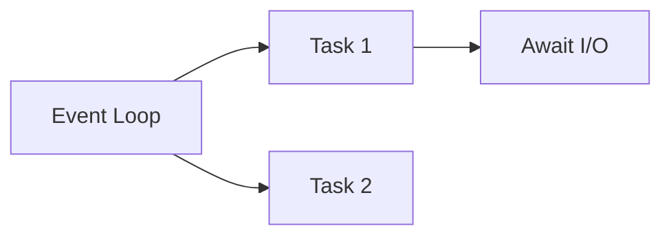

# Async Programming

## Overview

- **What is it?** Async programming coordinates many I/O tasks with async/await and an event loop.
- **Why is it important?** It scales concurrent network I/O without thread-per-connection overhead.
- **Where is it used?** Web servers, websockets, chat, microservices, IoT gateways.

## Learning Objectives

- **Skills gained:** Practical command of Async Programming.
- **Concepts covered:**

- Define async def and await coroutines.
- Run asyncio.run main loops.
- Gather concurrent tasks.

- **Expected outcome:** You build concurrent I/O services with asyncio.

## Real World Applications

- Real-time APIs
- Streaming platforms
- Telecom
- Fintech feeds

- **Business applications:** Automate workflows, reduce manual errors, accelerate delivery.
- **Career relevance:** Required knowledge for Python roles from junior developer to senior engineer.

## Core Concepts

### async def

- **Definition:** Defines coroutine function.
- **Visual explanation:** `async def` → process → result
- **Practical example:**

```python
async def hi():
    return 'hi'
```

### await

- **Definition:** Pause until awaitable completes.
- **Visual explanation:** `await` → process → result
- **Practical example:**

```python
import asyncio
async def main():
    await asyncio.sleep(0)
    return 1
print(asyncio.run(main()))
```

### gather

- **Definition:** Run tasks concurrently.
- **Visual explanation:** `gather` → process → result
- **Practical example:**

```python
import asyncio
async def work(n):
    return n
async def main():
    print(await asyncio.gather(work(1), work(2)))
asyncio.run(main())
```

## Infographic Summary

| Block | Summary |
| --- | --- |
| 📌 Concept | Event loop schedules awaitable tasks cooperatively. |
| ⚡ Purpose | High concurrency for I/O-bound workloads. |
| 🔥 Benefits | Low memory vs threads, structured concurrency primitives. |
| 🎯 Use Cases | HTTP clients, websockets, background workers. |
| 🚀 Best Practices | Never block loop; use asyncio.to_thread for blocking code. |
| ❌ Common Mistakes | Blocking calls in async routes, unhandled task exceptions. |

## Syntax Guide

### Basic Syntax

```python
import asyncio


async def main():
    return 'done'


print(asyncio.run(main()))
```

### Standard Structure

```python
create coroutines -> schedule -> await results
```

### Code Pattern

```python
await asyncio.gather(*tasks)
```

## Examples

### Beginner Example

```python
import asyncio

async def greet(name: str) -> str:
    return f'Hello, {name}'

print(asyncio.run(greet('Ada')))
```

### Intermediate Example

```python
import asyncio

async def fetch(n: int) -> int:
    await asyncio.sleep(0.01)
    return n * 2

async def main():
    results = await asyncio.gather(*(fetch(i) for i in range(3)))
    print(results)

asyncio.run(main())
```

### Advanced Example

```python
import asyncio

async def producer(queue: asyncio.Queue[int]) -> None:
    for i in range(3):
        await queue.put(i)
    await queue.put(-1)

async def consumer(queue: asyncio.Queue[int]) -> list[int]:
    items = []
    while True:
        item = await queue.get()
        if item == -1:
            break
        items.append(item * 2)
    return items

async def main():
    q: asyncio.Queue[int] = asyncio.Queue()
    prod = asyncio.create_task(producer(q))
    result = await consumer(q)
    await prod
    print(result)

asyncio.run(main())
```

## Workflow Diagram



---
