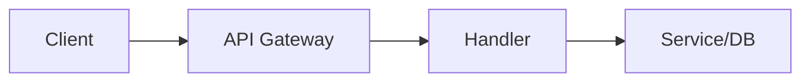

# API Development

## Overview

- **What is it?** API development builds HTTP (or RPC) interfaces for clients and services.
- **Why is it important?** APIs expose business capabilities to web and mobile clients and other services.
- **Where is it used?** SaaS products, mobile backends, partner integrations, ML serving.

## Learning Objectives

- **Skills gained:** Practical command of API Development.
- **Concepts covered:**

- Design RESTful routes and status codes.
- Validate request/response schemas.
- Implement auth and error handling.

- **Expected outcome:** You ship documented, testable HTTP APIs.

## Real World Applications

- Fintech APIs
- Health platforms
- E-commerce
- Internal platforms

- **Business applications:** Automate workflows, reduce manual errors, accelerate delivery.
- **Career relevance:** Required knowledge for Python roles from junior developer to senior engineer.

## Core Concepts

### Routes

- **Definition:** Map paths to handlers.
- **Visual explanation:** `Routes` → process → result
- **Practical example:**

```python
ROUTES = {'/health': lambda: {'status': 'ok'}}
print(ROUTES['/health']())
```

### Status codes

- **Definition:** Communicate outcome.
- **Visual explanation:** `Status codes` → process → result
- **Practical example:**

```python
STATUS = {200: 'OK', 404: 'Not Found'}
print(STATUS[200])
```

### Schema validation

- **Definition:** Reject bad payloads early.
- **Visual explanation:** `Schema validation` → process → result
- **Practical example:**

```python
payload = {'email': 'a@b.com'}
assert 'email' in payload
```

## Infographic Summary

| Block | Summary |
| --- | --- |
| 📌 Concept | APIs are contracts between producer and consumer. |
| ⚡ Purpose | Enable interoperable software integration. |
| 🔥 Benefits | Decoupling, multi-client support, monetization. |
| 🎯 Use Cases | CRUD resources, webhooks, public developer platforms. |
| 🚀 Best Practices | Version APIs; paginate lists; consistent errors; OpenAPI docs. |
| ❌ Common Mistakes | Breaking changes, no auth, leaking stack traces. |

## Syntax Guide

### Basic Syntax

```python
def get_user(user_id: int) -> dict:
    return {'id': user_id}
```

### Standard Structure

```python
router -> handler -> service -> repository
```

### Code Pattern

```python
def read_item(item_id: int) -> dict:
    return {'id': item_id}


print(read_item(1))
```

## Examples

### Beginner Example

```python
def create_response(data: dict, status: int = 200) -> dict:
    return {'status': status, 'data': data}


print(create_response({'ok': True}))
```

### Intermediate Example

```python
from dataclasses import dataclass


@dataclass
class User:
    id: int
    email: str


USERS = {1: User(1, 'a@b.com')}


def get_user(user_id: int) -> User:
    if user_id not in USERS:
        raise KeyError('not found')
    return USERS[user_id]


print(get_user(1).email)
```

### Advanced Example

```python
from http.server import BaseHTTPRequestHandler, HTTPServer


class Handler(BaseHTTPRequestHandler):
    def do_GET(self):
        self.send_response(200)
        self.end_headers()
        self.wfile.write(b'{"status":"ok"}')


def run_server():
    server = HTTPServer(('127.0.0.1', 0), Handler)
    host, port = server.server_address
    print(f'listening {port}')
    server.handle_request()


run_server()
```

## Workflow Diagram



---
