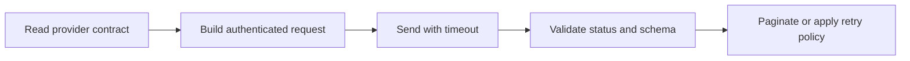

> **Level 2: Intermediate** · Topic 24 of 35

[← API Development](./23-api-development.md) · [↑ Level index](../README.md) · [Requests Library →](./25-requests-library.md)

# API Consumption

## Overview
- **What is it?** API Consumption is the intermediate Python topic of integrating with remote APIs as a reliable client, independent of a particular HTTP library.
- **Why is it important?** API consumption is the broader discipline of understanding contracts, authentication, pagination, rate limits, and failure modes.
- **Where is it used?** third-party integrations, data synchronization, service-to-service calls.

## Learning Objectives
- Read API contracts and encode parameters.
- Classify transport, HTTP, and payload failures.
- Implement pagination, authentication, and idempotent retries.

## Real World Applications
- **Engineering:** Third-party integrations rely on this topic.
- **Product work:** It supports data synchronization.
- **Operations:** It appears in service-to-service calls.

## Core Concepts

### Contract consumption
- **Definition:** A client must honor the provider's method, URL, headers, parameter encoding, and response schema.
- **Visual explanation:** ``client request -> API contract -> validated representation``
- **Practical example:**

```python
from urllib.parse import urlencode
query = urlencode({"page": 2, "limit": 50})
url = f"https://api.example.test/items?{query}"
```

### Failure layers
- **Definition:** DNS/TLS/timeouts are transport failures, non-success statuses are HTTP failures, and invalid bodies are representation failures.
- **Visual explanation:** ``transport -> status -> content-type -> schema``
- **Practical example:**

```python
def require_success(status: int):
    if not 200 <= status < 300:
        raise RuntimeError(f"HTTP {status}")
```

### Pagination and resilience
- **Definition:** Consumers follow provider pagination tokens and retry only safe operations with limits, backoff, and rate-limit awareness.
- **Visual explanation:** ``page -> next token -> page ... -> complete``
- **Practical example:**

```python
def pages(fetch):
    token = None
    while True:
        payload = fetch(token)
        yield from payload["items"]
        token = payload.get("next")
        if token is None:
            return
```

## Infographic Summary

| Infographic Block | Topic-specific guidance |
| --- | --- |
| 📌 Concept | Contract consumption, Failure layers, Pagination and resilience |
| ⚡ Purpose | API consumption is the broader discipline of understanding contracts, authentication, pagination, rate limits, and failure modes. |
| 🔥 Benefits | Reliable integrations, explicit failure classification, and safe pagination and retry behavior. |
| 🎯 Use Cases | third-party integrations, data synchronization, service-to-service calls |
| 🚀 Best Practices | Wrap the remote contract in a small client and validate every response before business use. |
| ❌ Common Mistakes | Retrying every failed POST automatically, risking duplicate side effects. |

## Syntax Guide

### Basic Syntax

```python
from urllib.request import urlopen
import json

with urlopen(url, timeout=5) as response:
    payload = json.load(response)
```

### Standard Structure

```python
def fetch_page(client, token=None):
    payload = client.get_items(page_token=token)
    if not isinstance(payload.get("items"), list):
        raise ValueError("items must be a list")
    return payload
```

### Code Pattern

```python
# Build request from the published contract.
# Set authentication and a finite timeout.
# Check transport, status, and payload shape.
# Follow pagination and retry policy deliberately.
```

## Examples

### Beginner Example

```python
from urllib.parse import urlencode

parameters = urlencode({"query": "python api", "limit": 10})
url = f"https://api.example.test/search?{parameters}"
print(url)
```

### Intermediate Example

```python
import json
from urllib.error import HTTPError, URLError
from urllib.request import Request, urlopen

def get_json(url: str, token: str) -> dict:
    request = Request(url, headers={"Authorization": f"Bearer {token}"})
    try:
        with urlopen(request, timeout=5) as response:
            if response.headers.get_content_type() != "application/json":
                raise ValueError("expected JSON response")
            return json.load(response)
    except HTTPError as error:
        raise RuntimeError(f"API returned {error.code}") from error
    except URLError as error:
        raise ConnectionError("API unavailable") from error
```

### Advanced Example

```python
def iter_resources(fetch_page):
    token = None
    seen_tokens = set()
    while True:
        payload = fetch_page(token)
        items = payload.get("items")
        if not isinstance(items, list):
            raise ValueError("response.items must be a list")
        yield from items
        token = payload.get("next_page_token")
        if token is None:
            return
        if token in seen_tokens:
            raise RuntimeError("pagination token repeated")
        seen_tokens.add(token)

responses = {
    None: {"items": [1, 2], "next_page_token": "p2"},
    "p2": {"items": [3], "next_page_token": None},
}
print(list(iter_resources(responses.__getitem__)))
```

## Workflow Diagram



---

[← API Development](./23-api-development.md) · [↑ Level index](../README.md) · [Requests Library →](./25-requests-library.md)
