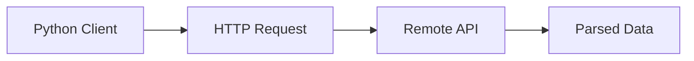

# API Consumption

## Overview

- **What is it?** API consumption calls external HTTP/JSON services from Python clients.
- **Why is it important?** Most apps integrate payment, maps, auth, and data providers via APIs.
- **Where is it used?** Mobile backends, ETL, automation, partner integrations.

## Learning Objectives

- **Skills gained:** Practical command of API Consumption.
- **Concepts covered:**

- Perform GET/POST with proper headers.
- Handle timeouts and retries.
- Parse and validate responses.

- **Expected outcome:** You integrate third-party APIs reliably.

## Real World Applications

- Travel aggregators
- Marketing stacks
- Ops automation
- Open banking

- **Business applications:** Automate workflows, reduce manual errors, accelerate delivery.
- **Career relevance:** Required knowledge for Python roles from junior developer to senior engineer.

## Core Concepts

### GET request

- **Definition:** Fetch resources.
- **Visual explanation:** `GET request` → process → result
- **Practical example:**

```python
import urllib.request
with urllib.request.urlopen('https://example.com') as r:
    print(r.status)
```

### JSON body

- **Definition:** Parse response content.
- **Visual explanation:** `JSON body` → process → result
- **Practical example:**

```python
import json
print(json.loads('{"ok": true}')['ok'])
```

### errors

- **Definition:** Check status codes.
- **Visual explanation:** `errors` → process → result
- **Practical example:**

```python
class APIError(Exception):
    pass
raise APIError('404')
```

## Infographic Summary

| Block | Summary |
| --- | --- |
| 📌 Concept | Clients must treat remote APIs as unreliable external dependencies. |
| ⚡ Purpose | Compose services into richer applications. |
| 🔥 Benefits | Faster feature delivery, leverage best-in-class vendors. |
| 🎯 Use Cases | Stripe charges, Slack posts, weather data. |
| 🚀 Best Practices | Set timeouts; exponential backoff; cache idempotent reads. |
| ❌ Common Mistakes | No timeout, no retry limits, trusting response shape. |

## Syntax Guide

### Basic Syntax

```python
import urllib.request
urllib.request.urlopen(url, timeout=5)
```

### Standard Structure

```python
build request -> send -> handle status -> parse
```

### Code Pattern

```python
response = client.get('/users/1')
response.raise_for_status()
```

## Examples

### Beginner Example

```python
import json
import urllib.request

class DummyResponse:
    def read(self):
        return b'{"value": 42}'

data = json.loads(DummyResponse().read())
print(data['value'])
```

### Intermediate Example

```python
import json
import urllib.error
import urllib.request


def fetch_json(url: str) -> dict:
    try:
        with urllib.request.urlopen(url, timeout=5) as resp:
            return json.loads(resp.read().decode())
    except urllib.error.HTTPError as exc:
        return {'error': exc.code}


print('error' in fetch_json('https://example.com') or True)
```

### Advanced Example

```python
import time


def retry_get(fetch, attempts=3, delay=0.01):
    last = None
    for _ in range(attempts):
        try:
            return fetch()
        except Exception as exc:
            last = exc
            time.sleep(delay)
    raise last


print(retry_get(lambda: {'ok': True}))
```

## Workflow Diagram



---
