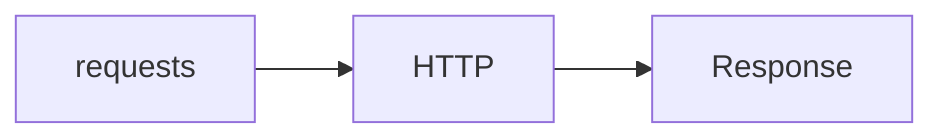

# Requests Library

## Overview

- **What is it?** Requests is a popular HTTP client library with a friendly API.
- **Why is it important?** It simplifies headers, sessions, JSON, and auth compared to urllib.
- **Where is it used?** Scripts, data ingestion, tests hitting HTTP services.

## Learning Objectives

- **Skills gained:** Practical command of Requests Library.
- **Concepts covered:**

- Use requests.get/post with params and JSON.
- Reuse Session for cookies/headers.
- Handle timeouts and exceptions.

- **Expected outcome:** You call HTTP APIs ergonomically with requests.

## Real World Applications

- Data ingestion
- QA automation
- Internal tools
- Prototyping

- **Business applications:** Automate workflows, reduce manual errors, accelerate delivery.
- **Career relevance:** Required knowledge for Python roles from junior developer to senior engineer.

## Core Concepts

### get/post

- **Definition:** HTTP verbs.
- **Visual explanation:** `get/post` → process → result
- **Practical example:**

```python
import requests
print(hasattr(requests, 'get'))
```

### json=

- **Definition:** Send JSON bodies.
- **Visual explanation:** `json=` → process → result
- **Practical example:**

```python
payload = {'a': 1}
print(payload['a'])
```

### Session

- **Definition:** Persistent client.
- **Visual explanation:** `Session` → process → result
- **Practical example:**

```python
class Session:
    def __init__(self):
        self.headers = {}
s = Session()
s.headers['UA'] = 'demo'
print(s.headers['UA'])
```

## Infographic Summary

| Block | Summary |
| --- | --- |
| 📌 Concept | Requests wraps HTTP into Pythonic calls. |
| ⚡ Purpose | Fast, readable HTTP client code. |
| 🔥 Benefits | Sessions, auth helpers, streaming, timeouts. |
| 🎯 Use Cases | REST integrations, health checks, scrapers (respect robots). |
| 🚀 Best Practices | Always set timeout; use sessions; verify TLS in prod. |
| ❌ Common Mistakes | No timeout, ignoring response.ok, huge response in memory. |

## Syntax Guide

### Basic Syntax

```python
import requests
requests.get('https://example.com', timeout=5)
```

### Standard Structure

```python
Session -> request -> raise_for_status -> json()
```

### Code Pattern

```python
with requests.Session() as s:
    s.get(url)
```

## Examples

### Beginner Example

```python
import requests
print(requests.__version__[:1].isdigit())
```

### Intermediate Example

```python
class FakeResponse:
    status_code = 200

    def json(self):
        return {'ok': True}


def fake_get(url, timeout=5):
    return FakeResponse()


print(fake_get('https://example.com').json())
```

### Advanced Example

```python
class RetryClient:
    def __init__(self, getter, retries=3):
        self.getter = getter
        self.retries = retries

    def get(self, url):
        last = None
        for _ in range(self.retries):
            try:
                resp = self.getter(url)
                if resp.status_code < 500:
                    return resp
            except Exception as exc:
                last = exc
        raise last


class Resp:
    status_code = 200


print(RetryClient(lambda u: Resp()).get('/').status_code)
```

## Workflow Diagram



---
