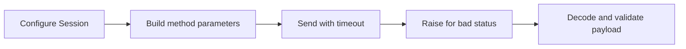

> **Level 2: Intermediate** · Topic 25 of 35

[← API Consumption](./24-api-consumption.md) · [↑ Level index](../README.md) · [Database Fundamentals →](./26-database-fundamentals.md)

# Requests Library

## Overview
- **What is it?** Requests Library is the intermediate Python topic of sending HTTP requests with the third-party requests library.
- **Why is it important?** Requests provides ergonomic sessions, parameter encoding, response decoding, exceptions, and adapter-based retry configuration.
- **Where is it used?** REST clients, webhook delivery, service health checks.

## Learning Objectives
- Use params, json, headers, timeout, and raise_for_status.
- Reuse connections with Session.
- Configure narrow retries with urllib3 Retry.

## Real World Applications
- **Engineering:** Rest clients rely on this topic.
- **Product work:** It supports webhook delivery.
- **Operations:** It appears in service health checks.

## Core Concepts

### Request and response
- **Definition:** requests builds an HTTP request from method arguments and returns a Response with status, headers, bytes, text, and JSON helpers.
- **Visual explanation:** ``requests.get -> Response -> status/content``
- **Practical example:**

```python
import requests
response = requests.get("https://example.com", timeout=5)
response.raise_for_status()
```

### Sessions
- **Definition:** A Session persists headers, cookies, and connection pools across calls, reducing setup overhead and centralizing policy.
- **Visual explanation:** ``Session policy + connection pool -> many requests``
- **Practical example:**

```python
import requests
session = requests.Session()
session.headers["User-Agent"] = "lesson-client/1.0"
```

### Timeouts and retries
- **Definition:** A timeout bounds connection and read waits; retries should target transient failures and idempotent methods.
- **Visual explanation:** ``request -> finite timeout -> selected retry/backoff -> failure``
- **Practical example:**

```python
import requests
response = requests.get("https://example.com", timeout=(2, 10))
```

## Infographic Summary

| Infographic Block | Topic-specific guidance |
| --- | --- |
| 📌 Concept | Request and response, Sessions, Timeouts and retries |
| ⚡ Purpose | Requests provides ergonomic sessions, parameter encoding, response decoding, exceptions, and adapter-based retry configuration. |
| 🔥 Benefits | Concise HTTP clients, pooled connections, and centralized timeout, status, and retry policy. |
| 🎯 Use Cases | REST clients, webhook delivery, service health checks |
| 🚀 Best Practices | Always set a finite timeout and call raise_for_status before trusting the body. |
| ❌ Common Mistakes | Using response.json() as proof that the status was successful or the schema is valid. |

## Syntax Guide

### Basic Syntax

```python
import requests

response = requests.get(
    "https://api.example.test/items",
    params={"limit": 10},
    timeout=5,
)
response.raise_for_status()
```

### Standard Structure

```python
import requests

with requests.Session() as session:
    session.headers.update({"Accept": "application/json"})
    response = session.post(
        "https://api.example.test/jobs",
        json={"task": "index"},
        timeout=(2, 10),
    )
    response.raise_for_status()
```

### Code Pattern

```python
# Reuse a configured Session.
# Encode query with params or body with json.
# Set connect/read timeout.
# raise_for_status, decode, then validate schema.
```

## Examples

### Beginner Example

```python
import requests

response = requests.get(
    "https://httpbin.org/get",
    params={"topic": "python"},
    timeout=5,
)
response.raise_for_status()
print(response.json()["args"])
```

### Intermediate Example

```python
import requests

def create_job(session: requests.Session, task: str) -> dict:
    response = session.post(
        "https://api.example.test/jobs",
        json={"task": task},
        headers={"Idempotency-Key": f"job-{task}"},
        timeout=(2, 10),
    )
    response.raise_for_status()
    payload = response.json()
    if not isinstance(payload.get("id"), str):
        raise ValueError("response requires string id")
    return payload
```

### Advanced Example

```python
import requests
from requests.adapters import HTTPAdapter
from urllib3.util.retry import Retry

retry = Retry(
    total=3,
    backoff_factor=0.5,
    status_forcelist=(429, 502, 503, 504),
    allowed_methods=frozenset({"GET", "HEAD"}),
    respect_retry_after_header=True,
)

with requests.Session() as session:
    session.mount("https://", HTTPAdapter(max_retries=retry))
    session.headers["User-Agent"] = "catalog-client/1.0"
    response = session.get(
        "https://api.example.test/catalog",
        timeout=(2, 10),
    )
    response.raise_for_status()
    catalog = response.json()
```

## Workflow Diagram



---

[← API Consumption](./24-api-consumption.md) · [↑ Level index](../README.md) · [Database Fundamentals →](./26-database-fundamentals.md)
