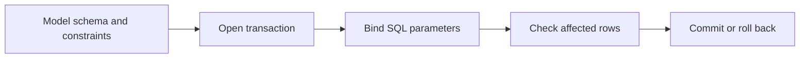

> **Level 2: Intermediate** · Topic 26 of 35

[← Requests Library](./25-requests-library.md) · [↑ Level index](../README.md) · [SQLite →](./27-sqlite.md)

# Database Fundamentals

## Overview
- **What is it?** Database fundamentals cover relational modeling, SQL, transactions, and DB-API concepts used from Python.
- **Why is it important?** Persistent data is the core of most products; incorrect SQL or transactions destroy integrity.
- **Where is it used?** CRUD apps, analytics extracts, reporting, and any system with durable business records.

## Learning Objectives
- Model tables, keys, and relationships.
- Use parameterized SQL and transactions.
- Understand connections, cursors, commits, and rollbacks.

## Real World Applications
- Design normalized schemas for users, orders, and inventory.
- Use transactions to keep multi-table writes consistent.
- Parameterize queries to prevent SQL injection.

## Core Concepts

### Relational schema
- **Definition:** A schema defines tables, typed columns, keys, constraints, and relationships that preserve data meaning.
- **Visual explanation:** ``entity -> table; identity -> primary key; relation -> foreign key``
- **Practical example:**

```python
schema = '''
CREATE TABLE customer (
    id INTEGER PRIMARY KEY,
    email TEXT NOT NULL UNIQUE
)
'''
```

### Parameterized SQL
- **Definition:** Parameters send values separately from SQL structure, preserving types and preventing injection through data.
- **Visual explanation:** ``SQL template + bound values -> driver -> database``
- **Practical example:**

```python
cursor.execute(
    "SELECT id FROM customer WHERE email = ?",
    ("ada@example.com",),
)
```

### Transactions
- **Definition:** A transaction groups statements into an atomic unit that commits entirely or rolls back on failure.
- **Visual explanation:** ``BEGIN -> statements -> COMMIT | ROLLBACK``
- **Practical example:**

```python
try:
    connection.execute("UPDATE account SET balance = balance - ?", (10,))
    connection.commit()
except Exception:
    connection.rollback()
    raise
```

## Infographic Summary

| Infographic Block | Topic-specific guidance |
| --- | --- |
| 📌 Concept | Database fundamentals cover relational modeling, SQL, transactions, and DB-API concepts used from Python. |
| ⚡ Purpose | Database fundamentals explain schemas and consistency independently of a specific driver or ORM. |
| 🔥 Benefits | Durable relational state, injection-safe queries, and atomic consistency through transactions. |
| 🎯 Use Cases | transactional applications, reporting stores, durable service state |
| 🚀 Best Practices | Enforce invariants with database constraints as well as application validation. |
| ❌ Common Mistakes | Interpolating values into SQL with f-strings. |

## Syntax Guide

### Basic Syntax

```python
cursor.execute(
    "SELECT name FROM users WHERE id = ?",
    (user_id,),
)
row = cursor.fetchone()
```

### Standard Structure

```python
try:
    cursor.execute(debit_sql, (amount, source_id))
    cursor.execute(credit_sql, (amount, target_id))
    connection.commit()
except Exception:
    connection.rollback()
    raise
```

### Code Pattern

```python
# Acquire a connection from a pool.
# Execute parameterized statements.
# Fetch only required columns and rows.
# Commit the unit or roll back every change.
```

## Examples

### Beginner Example

```python
import sqlite3

connection = sqlite3.connect(":memory:")
connection.execute("CREATE TABLE users (id INTEGER PRIMARY KEY, name TEXT NOT NULL)")
connection.execute("INSERT INTO users (name) VALUES (?)", ("Ada",))
print(connection.execute("SELECT id, name FROM users").fetchall())
connection.close()
```

### Intermediate Example

```python
import sqlite3

with sqlite3.connect(":memory:") as connection:
    connection.execute(
        "CREATE TABLE account (id INTEGER PRIMARY KEY, balance INTEGER CHECK (balance >= 0))"
    )
    connection.executemany(
        "INSERT INTO account VALUES (?, ?)",
        [(1, 100), (2, 20)],
    )
    connection.execute("UPDATE account SET balance = balance - ? WHERE id = ?", (25, 1))
    connection.execute("UPDATE account SET balance = balance + ? WHERE id = ?", (25, 2))
    print(connection.execute("SELECT * FROM account ORDER BY id").fetchall())
```

### Advanced Example

```python
import sqlite3

def transfer(connection, source_id: int, target_id: int, amount: int):
    if amount <= 0:
        raise ValueError("amount must be positive")
    with connection:
        debit = connection.execute(
            "UPDATE account SET balance = balance - ? "
            "WHERE id = ? AND balance >= ?",
            (amount, source_id, amount),
        )
        if debit.rowcount != 1:
            raise ValueError("source missing or insufficient funds")
        credit = connection.execute(
            "UPDATE account SET balance = balance + ? WHERE id = ?",
            (amount, target_id),
        )
        if credit.rowcount != 1:
            raise ValueError("target account missing")

connection = sqlite3.connect(":memory:")
connection.execute(
    "CREATE TABLE account (id INTEGER PRIMARY KEY, balance INTEGER CHECK (balance >= 0))"
)
connection.executemany(
    "INSERT INTO account VALUES (?, ?)",
    [(1, 100), (2, 20)],
)
transfer(connection, source_id=1, target_id=2, amount=25)
print(connection.execute("SELECT * FROM account ORDER BY id").fetchall())
```

## Workflow Diagram



---

[← Requests Library](./25-requests-library.md) · [↑ Level index](../README.md) · [SQLite →](./27-sqlite.md)
