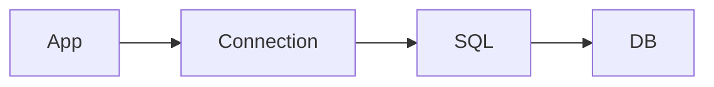

# Database Fundamentals

## Overview

- **What is it?** Database fundamentals cover relational models, SQL, transactions, and connections.
- **Why is it important?** Persistent structured storage underpins most applications.
- **Where is it used?** CRUD apps, analytics, auth systems, inventory, billing.

## Learning Objectives

- **Skills gained:** Practical command of Database Fundamentals.
- **Concepts covered:**

- Explain tables, keys, and relationships.
- Write basic SELECT/INSERT/UPDATE.
- Understand ACID transactions.

- **Expected outcome:** You design and query relational data confidently.

## Real World Applications

- Banking
- Retail
- Healthcare records
- SaaS multitenant

- **Business applications:** Automate workflows, reduce manual errors, accelerate delivery.
- **Career relevance:** Required knowledge for Python roles from junior developer to senior engineer.

## Core Concepts

### Table

- **Definition:** Rows and columns.
- **Visual explanation:** `Table` → process → result
- **Practical example:**

```python
ROW = {'id': 1, 'name': 'Ada'}
print(ROW['name'])
```

### Primary key

- **Definition:** Unique row identifier.
- **Visual explanation:** `Primary key` → process → result
- **Practical example:**

```python
ids = {1, 2}
assert len(ids) == 2
```

### Transaction

- **Definition:** All-or-nothing changes.
- **Visual explanation:** `Transaction` → process → result
- **Practical example:**

```python
balance = 100
balance -= 30
assert balance == 70
```

## Infographic Summary

| Block | Summary |
| --- | --- |
| 📌 Concept | Relational DBs store normalized data queried with SQL. |
| ⚡ Purpose | Durable, queryable structured storage. |
| 🔥 Benefits | Consistency, joins, mature tooling. |
| 🎯 Use Cases | Users, orders, ledgers, inventory. |
| 🚀 Best Practices | Use migrations; index wisely; least privilege credentials. |
| ❌ Common Mistakes | N+1 queries, no transactions, string-built SQL (injection). |

## Syntax Guide

### Basic Syntax

```python
SQL = 'SELECT id, name FROM users WHERE active = 1'
print(SQL.split()[0])
```

### Standard Structure

```python
connect -> cursor -> execute -> commit/rollback
```

### Code Pattern

```python
BEGIN -> statements -> COMMIT
```

## Examples

### Beginner Example

```python
SQL = 'SELECT 1 AS one'
print(SQL.split()[0])
```

### Intermediate Example

```python
def transfer(balance: dict, src: str, dst: str, amount: float) -> None:
    if balance[src] < amount:
        raise ValueError('insufficient funds')
    balance[src] -= amount
    balance[dst] += amount


b = {'A': 100.0, 'B': 0.0}
transfer(b, 'A', 'B', 40)
print(b)
```

### Advanced Example

```python
class Transaction:
    def __init__(self, conn):
        self.conn = conn

    def __enter__(self):
        self.conn['in_tx'] = True
        return self.conn

    def __exit__(self, exc_type, exc, tb):
        self.conn['in_tx'] = False
        self.conn['committed'] = exc_type is None
        return False


conn = {'in_tx': False, 'committed': False}
with Transaction(conn):
    conn['rows'] = 1
print(conn['committed'])
```

## Workflow Diagram



---
