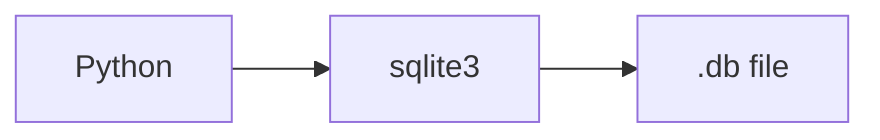

# SQLite

## Overview

- **What is it?** SQLite is a serverless embedded SQL database in a single file.
- **Why is it important?** It is ideal for local apps, prototypes, tests, and edge devices.
- **Where is it used?** Mobile apps, desktop tools, unit tests, small web apps.

## Learning Objectives

- **Skills gained:** Practical command of SQLite.
- **Concepts covered:**

- Connect with sqlite3 module.
- Execute SQL safely with parameters.
- Use context managers for connections.

- **Expected outcome:** You persist data locally with SQLite and Python.

## Real World Applications

- Mobile
- IoT gateways
- Developer tools
- Testing

- **Business applications:** Automate workflows, reduce manual errors, accelerate delivery.
- **Career relevance:** Required knowledge for Python roles from junior developer to senior engineer.

## Core Concepts

### connect

- **Definition:** Open database file.
- **Visual explanation:** `connect` → process → result
- **Practical example:**

```python
import sqlite3
conn = sqlite3.connect(':memory:')
print(type(conn).__name__)
```

### parameterized SQL

- **Definition:** Prevent injection.
- **Visual explanation:** `parameterized SQL` → process → result
- **Practical example:**

```python
import sqlite3
conn = sqlite3.connect(':memory:')
conn.execute('CREATE TABLE t (id INTEGER)')
conn.execute('INSERT INTO t VALUES (?)', (1,))
print(conn.execute('SELECT id FROM t').fetchone()[0])
```

### row factory

- **Definition:** Dict-like rows.
- **Visual explanation:** `row factory` → process → result
- **Practical example:**

```python
import sqlite3
conn = sqlite3.connect(':memory:')
conn.row_factory = sqlite3.Row
print(callable(conn.row_factory))
```

## Infographic Summary

| Block | Summary |
| --- | --- |
| 📌 Concept | SQLite runs in-process without separate server. |
| ⚡ Purpose | Lightweight relational persistence. |
| 🔥 Benefits | Zero config, fast for small/medium data, portable file. |
| 🎯 Use Cases | App cache DB, integration tests, prototypes. |
| 🚀 Best Practices | Use WAL mode for concurrency; migrate schema; backup file. |
| ❌ Common Mistakes | Writing SQL with f-strings, no indexes, huge blobs in DB. |

## Syntax Guide

### Basic Syntax

```python
import sqlite3
conn = sqlite3.connect('app.db')
```

### Standard Structure

```python
connect -> execute -> commit -> close
```

### Code Pattern

```python
conn.execute('SELECT id FROM users WHERE id=?', (user_id,))
```

## Examples

### Beginner Example

```python
import sqlite3

conn = sqlite3.connect(':memory:')
conn.execute('CREATE TABLE users (id INTEGER PRIMARY KEY, name TEXT)')
conn.execute('INSERT INTO users (name) VALUES (?)', ('Ada',))
print(conn.execute('SELECT name FROM users').fetchone()[0])
```

### Intermediate Example

```python
import sqlite3

with sqlite3.connect(':memory:') as conn:
    conn.execute('CREATE TABLE items (sku TEXT, qty INTEGER)')
    conn.executemany('INSERT INTO items VALUES (?, ?)', [('A', 2), ('B', 1)])
    total = conn.execute('SELECT SUM(qty) FROM items').fetchone()[0]
    print(total)
```

### Advanced Example

```python
import sqlite3

def init(conn: sqlite3.Connection) -> None:
    conn.execute('CREATE TABLE IF NOT EXISTS audit (id INTEGER PRIMARY KEY AUTOINCREMENT, msg TEXT)')
    conn.commit()


conn = sqlite3.connect(':memory:')
init(conn)
conn.execute('INSERT INTO audit (msg) VALUES (?)', ('created',))
print(conn.execute('SELECT COUNT(*) FROM audit').fetchone()[0])
```

## Workflow Diagram



---
