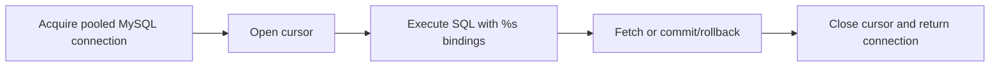

> **Level 2: Intermediate** · Topic 28 of 35

[← SQLite](./27-sqlite.md) · [↑ Level index](../README.md) · [PostgreSQL Integration →](./29-postgresql-integration.md)

# MySQL Integration

## Overview
- **What is it?** MySQL Integration is the intermediate Python topic of connecting Python applications to MySQL with a MySQL DB-API driver.
- **Why is it important?** MySQL integration requires server connection management, %s parameter binding, transactions, and production pooling.
- **Where is it used?** web application persistence, transactional business systems, MySQL-backed services.

## Learning Objectives
- Use mysql.connector connection and cursor patterns.
- Bind parameters with %s placeholders.
- Manage transactions, dictionary rows, and connection pools.

## Real World Applications
- **Engineering:** Web application persistence rely on this topic.
- **Product work:** It supports transactional business systems.
- **Operations:** It appears in MySQL-backed services.

## Core Concepts

### Driver connection
- **Definition:** A MySQL driver opens a network connection using host, credentials, and database settings; it should be closed or returned to a pool.
- **Visual explanation:** ``application -> MySQL driver -> TCP/TLS -> server``
- **Practical example:**

```python
import mysql.connector

connection = mysql.connector.connect(
    host="localhost", user="app", password="secret", database="shop"
)
```

### MySQL parameters and cursors
- **Definition:** Connector/Python binds values with %s placeholders and can return dictionary rows without interpolating SQL.
- **Visual explanation:** ``SQL with %s + tuple -> prepared execution -> rows``
- **Practical example:**

```python
cursor = connection.cursor(dictionary=True)
cursor.execute("SELECT id, email FROM users WHERE id = %s", (42,))
row = cursor.fetchone()
```

### Transactions and pooling
- **Definition:** Explicit commit or rollback defines write durability; pooling reuses bounded server connections across requests.
- **Visual explanation:** ``pool -> connection -> transaction -> return to pool``
- **Practical example:**

```python
try:
    connection.start_transaction()
    cursor.execute("UPDATE stock SET quantity = quantity - %s WHERE sku = %s", (1, "A1"))
    connection.commit()
except Exception:
    connection.rollback()
    raise
```

## Infographic Summary

| Infographic Block | Topic-specific guidance |
| --- | --- |
| 📌 Concept | Driver connection, MySQL parameters and cursors, Transactions and pooling |
| ⚡ Purpose | MySQL integration requires server connection management, %s parameter binding, transactions, and production pooling. |
| 🔥 Benefits | Safe MySQL queries, reusable server connections, and explicit transactional durability. |
| 🎯 Use Cases | web application persistence, transactional business systems, MySQL-backed services |
| 🚀 Best Practices | Use a supported driver, parameter binding, TLS in production, and a bounded pool. |
| ❌ Common Mistakes | Copying sqlite3 placeholders or APIs into MySQL code. |

## Syntax Guide

### Basic Syntax

```python
import mysql.connector

connection = mysql.connector.connect(**database_config)
cursor = connection.cursor()
cursor.execute("SELECT name FROM users WHERE id = %s", (user_id,))
row = cursor.fetchone()
cursor.close()
connection.close()
```

### Standard Structure

```python
from mysql.connector.pooling import MySQLConnectionPool

pool = MySQLConnectionPool(pool_name="app", pool_size=5, **database_config)
with pool.get_connection() as connection:
    with connection.cursor(dictionary=True) as cursor:
        cursor.execute("SELECT id, email FROM users WHERE active = %s", (True,))
        users = cursor.fetchall()
```

### Code Pattern

```python
# Acquire a TLS-configured pooled connection.
# Open the appropriate cursor type.
# Bind values with %s placeholders.
# Commit/rollback and return connection to pool.
```

## Examples

### Beginner Example

```python
import mysql.connector

connection = mysql.connector.connect(
    host="127.0.0.1",
    user="app",
    password="secret",
    database="learning",
)
try:
    cursor = connection.cursor()
    cursor.execute("SELECT id, name FROM course WHERE id = %s", (1,))
    print(cursor.fetchone())
    cursor.close()
finally:
    connection.close()
```

### Intermediate Example

```python
import mysql.connector

def add_user(config: dict, email: str) -> int:
    with mysql.connector.connect(**config) as connection:
        with connection.cursor() as cursor:
            try:
                cursor.execute(
                    "INSERT INTO users (email) VALUES (%s)",
                    (email,),
                )
                connection.commit()
                return cursor.lastrowid
            except mysql.connector.Error:
                connection.rollback()
                raise
```

### Advanced Example

```python
from mysql.connector.pooling import MySQLConnectionPool

class UserRepository:
    def __init__(self, config: dict):
        self.pool = MySQLConnectionPool(
            pool_name="users",
            pool_size=5,
            pool_reset_session=True,
            **config,
        )

    def active_users(self, limit: int) -> list[dict]:
        if not 1 <= limit <= 100:
            raise ValueError("limit out of range")
        with self.pool.get_connection() as connection:
            with connection.cursor(dictionary=True) as cursor:
                cursor.execute(
                    "SELECT id, email FROM users "
                    "WHERE active = %s ORDER BY id LIMIT %s",
                    (True, limit),
                )
                return cursor.fetchall()
```

## Workflow Diagram



---

[← SQLite](./27-sqlite.md) · [↑ Level index](../README.md) · [PostgreSQL Integration →](./29-postgresql-integration.md)
