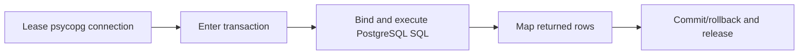

> **Level 2: Intermediate** · Topic 29 of 35

[← MySQL Integration](./28-mysql-integration.md) · [↑ Level index](../README.md) · [SQLAlchemy ORM →](./30-sqlalchemy-orm.md)

# PostgreSQL Integration

## Overview
- **What is it?** PostgreSQL Integration is the intermediate Python topic of connecting Python applications to PostgreSQL with psycopg 3.
- **Why is it important?** psycopg provides safe %s binding, context-managed transactions, row factories, pools, and PostgreSQL-specific capabilities.
- **Where is it used?** transactional services, analytics backends, PostgreSQL feature-rich applications.

## Learning Objectives
- Use psycopg 3 connections and cursors.
- Configure dict_row and transaction scopes.
- Use psycopg_pool for bounded production connections.

## Real World Applications
- **Engineering:** Transactional services rely on this topic.
- **Product work:** It supports analytics backends.
- **Operations:** It appears in PostgreSQL feature-rich applications.

## Core Concepts

### psycopg connections
- **Definition:** psycopg.connect opens a PostgreSQL session; a connection context commits on success, rolls back on error, and closes.
- **Visual explanation:** ``Python -> psycopg -> PostgreSQL session``
- **Practical example:**

```python
import psycopg

with psycopg.connect("dbname=learning user=app") as connection:
    row = connection.execute("SELECT current_database()").fetchone()
```

### Binding and row factories
- **Definition:** psycopg uses %s for all bound value types and row_factory to select tuple, dict, or typed row representations.
- **Visual explanation:** ``SQL + %s values -> server; row factory -> Python shape``
- **Practical example:**

```python
from psycopg.rows import dict_row
with connection.cursor(row_factory=dict_row) as cursor:
    cursor.execute("SELECT id FROM users WHERE email = %s", ("ada@example.com",))
```

### Transactions and pools
- **Definition:** Nested connection.transaction blocks create explicit scopes; ConnectionPool controls reusable concurrent sessions.
- **Visual explanation:** ``ConnectionPool -> transaction -> commit/rollback -> pool``
- **Practical example:**

```python
with connection.transaction():
    connection.execute("UPDATE counters SET value = value + 1 WHERE name = %s", ("jobs",))
```

## Infographic Summary

| Infographic Block | Topic-specific guidance |
| --- | --- |
| 📌 Concept | psycopg connections, Binding and row factories, Transactions and pools |
| ⚡ Purpose | psycopg provides safe %s binding, context-managed transactions, row factories, pools, and PostgreSQL-specific capabilities. |
| 🔥 Benefits | Typed PostgreSQL rows, concise transaction scopes, and bounded production connection reuse. |
| 🎯 Use Cases | transactional services, analytics backends, PostgreSQL feature-rich applications |
| 🚀 Best Practices | Use psycopg SQL composition for identifiers and parameters only for values. |
| ❌ Common Mistakes | Using Python string formatting to insert table names or values into SQL. |

## Syntax Guide

### Basic Syntax

```python
import psycopg

with psycopg.connect(connection_string) as connection:
    row = connection.execute(
        "SELECT name FROM users WHERE id = %s",
        (user_id,),
    ).fetchone()
```

### Standard Structure

```python
from psycopg.rows import dict_row

with connection.cursor(row_factory=dict_row) as cursor:
    cursor.execute(
        "SELECT id, email FROM users WHERE active = %s ORDER BY id",
        (True,),
    )
    users = cursor.fetchall()
```

### Code Pattern

```python
# Acquire a psycopg connection or pool lease.
# Begin the intended transaction scope.
# Bind values with %s; compose identifiers safely.
# Commit/rollback and release the session.
```

## Examples

### Beginner Example

```python
import psycopg

with psycopg.connect("dbname=learning user=app") as connection:
    with connection.cursor() as cursor:
        cursor.execute("SELECT id, title FROM course WHERE id = %s", (1,))
        print(cursor.fetchone())
```

### Intermediate Example

```python
import psycopg
from psycopg.rows import dict_row

def create_task(connection: psycopg.Connection, title: str) -> dict:
    with connection.cursor(row_factory=dict_row) as cursor:
        cursor.execute(
            "INSERT INTO task (title) VALUES (%s) "
            "RETURNING id, title, created_at",
            (title,),
        )
        task = cursor.fetchone()
        if task is None:
            raise RuntimeError("insert returned no row")
        return task

with psycopg.connect("dbname=learning user=app") as connection:
    print(create_task(connection, "Learn psycopg"))
```

### Advanced Example

```python
from psycopg.rows import class_row
from psycopg_pool import ConnectionPool
from dataclasses import dataclass

@dataclass
class User:
    id: int
    email: str

pool = ConnectionPool(
    "dbname=learning user=app",
    min_size=1,
    max_size=8,
)

def find_user(user_id: int) -> User | None:
    with pool.connection() as connection:
        with connection.cursor(row_factory=class_row(User)) as cursor:
            cursor.execute(
                "SELECT id, email FROM users WHERE id = %s",
                (user_id,),
            )
            return cursor.fetchone()
```

## Workflow Diagram



---

[← MySQL Integration](./28-mysql-integration.md) · [↑ Level index](../README.md) · [SQLAlchemy ORM →](./30-sqlalchemy-orm.md)
