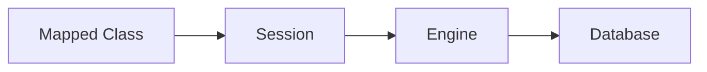

# SQLAlchemy ORM

## Overview

- **What is it?** SQLAlchemy ORM maps Python classes to database tables and queries.
- **Why is it important?** It reduces boilerplate SQL and eases schema evolution.
- **Where is it used?** Web apps, data services, admin tools, migration-heavy systems.

## Learning Objectives

- **Skills gained:** Practical command of SQLAlchemy ORM.
- **Concepts covered:**

- Declare mapped classes and sessions.
- Query with Session.query or select().
- Manage migrations with Alembic.

- **Expected outcome:** You persist domain objects with SQLAlchemy patterns.

## Real World Applications

- Django-adjacent services
- Enterprise apps
- Internal tools
- Analytics apps

- **Business applications:** Automate workflows, reduce manual errors, accelerate delivery.
- **Career relevance:** Required knowledge for Python roles from junior developer to senior engineer.

## Core Concepts

### Engine

- **Definition:** Connection factory.
- **Visual explanation:** `Engine` → process → result
- **Practical example:**

```python
class Engine:
    def connect(self):
        return {'connected': True}
print(Engine().connect())
```

### Session

- **Definition:** Unit of work.
- **Visual explanation:** `Session` → process → result
- **Practical example:**

```python
class Session:
    def add(self, obj):
        self.obj = obj
s = Session()
s.add({'id': 1})
print(s.obj)
```

### Mapped class

- **Definition:** Class <-> table.
- **Visual explanation:** `Mapped class` → process → result
- **Practical example:**

```python
class User:
    __tablename__ = 'users'
    id = 1
print(User.__tablename__)
```

## Infographic Summary

| Block | Summary |
| --- | --- |
| 📌 Concept | ORM translates objects to SQL and back. |
| ⚡ Purpose | Productive relational persistence in Python. |
| 🔥 Benefits | Composable queries, connection pooling, dialect abstraction. |
| 🎯 Use Cases | User models, orders, reporting entities. |
| 🚀 Best Practices | Explicit sessions; avoid lazy loading N+1; use Alembic. |
| ❌ Common Mistakes | Session leaks, implicit autoflush surprises, god models. |

## Syntax Guide

### Basic Syntax

```python
session.add(obj)
session.commit()
```

### Standard Structure

```python
engine -> sessionmaker -> session -> query/commit
```

### Code Pattern

```python
with Session(engine) as session:
    session.add(user)
```

## Examples

### Beginner Example

```python
class User:
    def __init__(self, email: str):
        self.email = email


user = User('a@b.com')
print(user.email)
```

### Intermediate Example

```python
class Repository:
    def __init__(self, session):
        self.session = session

    def create_user(self, email: str):
        user = {'email': email}
        self.session['users'] = self.session.get('users', []) + [user]
        return user


session = {}
repo = Repository(session)
print(repo.create_user('a@b.com'))
```

### Advanced Example

```python
class UnitOfWork:
    def __init__(self):
        self.new = []
        self.dirty = []

    def register_new(self, entity):
        self.new.append(entity)

    def commit(self):
        saved = len(self.new) + len(self.dirty)
        self.new.clear()
        self.dirty.clear()
        return saved


uow = UnitOfWork()
uow.register_new({'id': 1})
print(uow.commit())
```

## Workflow Diagram



---
