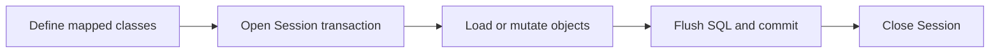

> **Level 2: Intermediate** · Topic 30 of 35

[← PostgreSQL Integration](./29-postgresql-integration.md) · [↑ Level index](../README.md) · [Unit Testing →](./31-unit-testing.md)

# SQLAlchemy ORM

## Overview
- **What is it?** SQLAlchemy ORM is the intermediate Python topic of mapping Python domain classes to relational tables with SQLAlchemy 2.x.
- **Why is it important?** The ORM unit of work tracks mapped objects and flushes SQL through an explicit Session transaction.
- **Where is it used?** backend persistence layers, complex relational domains, database-portable data access.

## Learning Objectives
- Declare 2.x typed mappings.
- Use select() and Session scopes.
- Model relationships and avoid hidden N+1 queries.

## Real World Applications
- **Engineering:** Backend persistence layers rely on this topic.
- **Product work:** It supports complex relational domains.
- **Operations:** It appears in database-portable data access.

## Core Concepts

### Declarative mappings
- **Definition:** DeclarativeBase, Mapped, and mapped_column connect typed class attributes to table columns.
- **Visual explanation:** ``mapped class <-> table metadata``
- **Practical example:**

```python
from sqlalchemy.orm import DeclarativeBase, Mapped, mapped_column

class Base(DeclarativeBase):
    pass

class User(Base):
    __tablename__ = "user"
    id: Mapped[int] = mapped_column(primary_key=True)
```

### Session and unit of work
- **Definition:** A Session is a short-lived identity map and transaction boundary that tracks changes and flushes SQL.
- **Visual explanation:** ``objects -> Session unit of work -> flush -> transaction``
- **Practical example:**

```python
from sqlalchemy.orm import Session

with Session(engine) as session, session.begin():
    session.add(User())
```

### 2.x queries and loading
- **Definition:** SQLAlchemy 2.x queries use select(); relationship loading should be chosen explicitly to control round trips.
- **Visual explanation:** ``select(User) -> execute -> scalars; selectinload -> bounded related query``
- **Practical example:**

```python
from sqlalchemy import select
statement = select(User).where(User.id == 1)
user = session.scalar(statement)
```

## Infographic Summary

| Infographic Block | Topic-specific guidance |
| --- | --- |
| 📌 Concept | Declarative mappings, Session and unit of work, 2.x queries and loading |
| ⚡ Purpose | The ORM unit of work tracks mapped objects and flushes SQL through an explicit Session transaction. |
| 🔥 Benefits | Typed relational mappings, coordinated units of work, and expressive database-independent querying. |
| 🎯 Use Cases | backend persistence layers, complex relational domains, database-portable data access |
| 🚀 Best Practices | Use one Session per request or job and pass it explicitly to repositories. |
| ❌ Common Mistakes | Keeping a global Session or relying on lazy loading after the Session closes. |

## Syntax Guide

### Basic Syntax

```python
from sqlalchemy import create_engine, select
from sqlalchemy.orm import Session

engine = create_engine("sqlite:///app.db")
with Session(engine) as session:
    users = session.scalars(select(User)).all()
```

### Standard Structure

```python
with Session(engine) as session:
    with session.begin():
        user = User(email="ada@example.com")
        session.add(user)
    session.refresh(user)
```

### Code Pattern

```python
# Define typed declarative mappings.
# Open a short-lived Session.
# Execute select() or change mapped objects.
# Commit transaction and close Session.
```

## Examples

### Beginner Example

```python
from sqlalchemy import create_engine, select
from sqlalchemy.orm import DeclarativeBase, Mapped, Session, mapped_column
class Base(DeclarativeBase):
    pass
class Course(Base):
    __tablename__ = "course"
    id: Mapped[int] = mapped_column(primary_key=True)
    title: Mapped[str]
engine = create_engine("sqlite:///:memory:")
Base.metadata.create_all(engine)
with Session(engine) as session:
    session.add(Course(title="Intermediate Python"))
    session.commit()
    print(session.scalars(select(Course)).one().title)
```

### Intermediate Example

```python
from sqlalchemy import create_engine, select
from sqlalchemy.orm import DeclarativeBase, Mapped, Session, mapped_column
class Base(DeclarativeBase):
    pass
class Task(Base):
    __tablename__ = "task"
    id: Mapped[int] = mapped_column(primary_key=True)
    title: Mapped[str]
    done: Mapped[bool] = mapped_column(default=False)
engine = create_engine("sqlite:///:memory:")
Base.metadata.create_all(engine)
with Session(engine) as session, session.begin():
    session.add_all([Task(title="Map model"), Task(title="Query model")])

with Session(engine) as session:
    open_tasks = session.scalars(
        select(Task).where(Task.done.is_(False)).order_by(Task.id)
    ).all()
    print([task.title for task in open_tasks])
```

### Advanced Example

```python
from sqlalchemy import ForeignKey, create_engine, select
from sqlalchemy.orm import DeclarativeBase, Mapped, Session, mapped_column, relationship, selectinload
class Base(DeclarativeBase):
    pass
class Author(Base):
    __tablename__ = "author"
    id: Mapped[int] = mapped_column(primary_key=True)
    name: Mapped[str]
    books: Mapped[list["Book"]] = relationship(back_populates="author")
class Book(Base):
    __tablename__ = "book"
    id: Mapped[int] = mapped_column(primary_key=True)
    title: Mapped[str]
    author_id: Mapped[int] = mapped_column(ForeignKey("author.id"))
    author: Mapped[Author] = relationship(back_populates="books")
engine = create_engine("sqlite:///:memory:")
Base.metadata.create_all(engine)
with Session(engine) as session, session.begin():
    session.add(Author(name="Ada", books=[Book(title="Python Systems")]))
with Session(engine) as session:
    query = select(Author).options(selectinload(Author.books))
    author = session.scalars(query).one()
    print([book.title for book in author.books])
```

## Workflow Diagram



---

[← PostgreSQL Integration](./29-postgresql-integration.md) · [↑ Level index](../README.md) · [Unit Testing →](./31-unit-testing.md)
