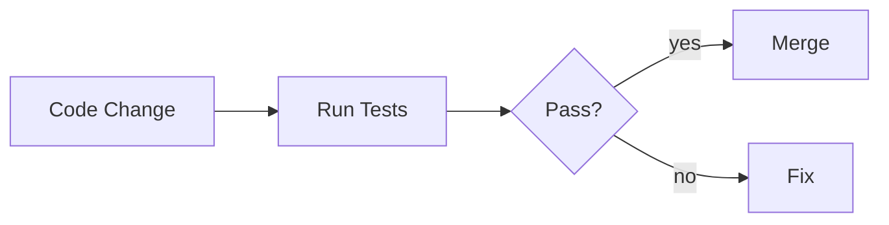

# Unit Testing

## Overview

- **What is it?** Unit testing verifies small units of code behave as expected automatically.
- **Why is it important?** Tests prevent regressions and document intended behavior.
- **Where is it used?** Every professional Python codebase and CI pipeline.

## Learning Objectives

- **Skills gained:** Practical command of Unit Testing.
- **Concepts covered:**

- Write tests with unittest or pytest.
- Use assertions and test cases.
- Organize tests mirroring package structure.

- **Expected outcome:** You protect core logic with fast automated unit tests.

## Real World Applications

- SaaS
- Libraries
- Quant systems
- Safety-critical tooling

- **Business applications:** Automate workflows, reduce manual errors, accelerate delivery.
- **Career relevance:** Required knowledge for Python roles from junior developer to senior engineer.

## Core Concepts

### test function

- **Definition:** Assert expected behavior.
- **Visual explanation:** `test function` → process → result
- **Practical example:**

```python
def test_add():
    assert 1 + 1 == 2
test_add()
```

### TestCase

- **Definition:** unittest grouping.
- **Visual explanation:** `TestCase` → process → result
- **Practical example:**

```python
import unittest
class Tests(unittest.TestCase):
    def test_true(self):
        self.assertTrue(True)
unittest.main(argv=[''], exit=False)
```

### arrange-act-assert

- **Definition:** Test structure.
- **Visual explanation:** `arrange-act-assert` → process → result
- **Practical example:**

```python
def test_double():
    value = 2
    result = value * 2
    assert result == 4
test_double()
```

## Infographic Summary

| Block | Summary |
| --- | --- |
| 📌 Concept | Unit tests isolate one behavior per test. |
| ⚡ Purpose | Catch bugs early and enable refactoring. |
| 🔥 Benefits | Confidence, living documentation, safer CI. |
| 🎯 Use Cases | Pure functions, validators, parsers. |
| 🚀 Best Practices | One assertion focus; descriptive names; fast tests. |
| ❌ Common Mistakes | Testing implementation details, flaky tests, no CI run. |

## Syntax Guide

### Basic Syntax

```python
def test_something():
    assert func() == expected
```

### Standard Structure

```python
arrange -> act -> assert
```

### Code Pattern

```python
result = system_under_test(input)
assert result == expected
```

## Examples

### Beginner Example

```python
def inc(x):
    return x + 1
assert inc(2) == 3
```

### Intermediate Example

```python
import unittest


def is_palindrome(text: str) -> bool:
    cleaned = text.lower().replace(' ', '')
    return cleaned == cleaned[::-1]


class PalindromeTests(unittest.TestCase):
    def test_palindrome(self):
        self.assertTrue(is_palindrome('Level'))


unittest.main(argv=[''], exit=False, verbosity=0)
```

### Advanced Example

```python
from dataclasses import dataclass


@dataclass
class TestResult:
    name: str
    passed: bool


def run_tests(cases):
    return [TestResult(name, fn()) for name, fn in cases]


print(run_tests([('ok', lambda: True)]))
```

## Workflow Diagram



---
