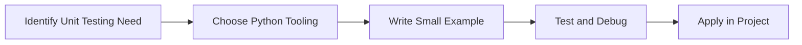

> **Level 2: Intermediate** · Topic 31 of 35

[← SQLAlchemy ORM](./30-sqlalchemy-orm.md) · [↑ Level index](../README.md) · [Pytest →](./32-pytest.md)

# Unit Testing

## Overview
- **What is it?** Unit Testing is a Python knowledge area focused on delivery quality.
- **Why is it important?** Help developers apply delivery quality techniques safely, clearly, and consistently.
- **Where is it used?** Reliable releases, automation tools, reusable packages, and developer productivity.

## Learning Objectives
- Gain the practical skill to explain, write, debug, and review unit testing code.
- Cover the vocabulary, syntax, workflow, edge cases, and professional habits behind unit testing.
- Expected outcome: you can use unit testing in a small project and recognize when it belongs in production code.

## Real World Applications
- **Industry use cases:** Reliable releases, automation tools, reusable packages, and developer productivity.
- **Business applications:** Reduce manual work, improve reliability, support reporting, automate decisions, and ship maintainable features.
- **Career relevance:** Supports Python developer, backend engineer, data engineer, AI engineer, DevOps engineer, QA automation, and cybersecurity automation roles.

## Core Concepts

### Mental Model
- **Definition:** The main idea that gives unit testing its structure and purpose inside a Python program.
- **Visual explanation:** `problem -> Unit Testing model -> clear code`
- **Practical example:**

```python
apply_unit_testing_label = "Unit Testing"
print(apply_unit_testing_label)
```

### Execution Flow
- **Definition:** The ordered steps Python follows when unit testing code is created, executed, or integrated.
- **Visual explanation:** `input -> Python operation -> result -> feedback`
- **Practical example:**

```python
def add(left, right):
    return left + right

assert add(2, 3) == 5
```

### Quality Rule
- **Definition:** The reliability habit that keeps unit testing understandable, testable, secure, and maintainable.
- **Visual explanation:** `working code -> validation -> production confidence`
- **Practical example:**

```python
import unittest

def normalize(value):
    return value.strip().lower()

class TestNormalize(unittest.TestCase):
    def test_normalize(self):
        self.assertEqual(normalize(" Python "), "python")
```

## Infographic Summary

| Infographic Block | Key Message |
| --- | --- |
| 📌 Concept | Unit Testing belongs to the delivery quality part of Python mastery. |
| ⚡ Purpose | Help developers apply delivery quality techniques safely, clearly, and consistently. |
| 🔥 Benefits | Stronger maintainability, better reliability, and more professional delivery quality decisions. |
| 🎯 Use Cases | Reliable releases, automation tools, reusable packages, and developer productivity. |
| 🚀 Best Practices | Prefer readable names, small examples, explicit errors, tests, documentation, and version-aware choices. |
| ❌ Common Mistakes | Copying code without understanding it, ignoring edge cases, skipping validation, and mixing unrelated responsibilities. |

## Syntax Guide

### Basic Syntax

```python
import unittest

class TestMath(unittest.TestCase):
    def test_add(self):
        self.assertEqual(1 + 1, 2)
```

### Standard Structure

```python
def apply_unit_testing(value):
    """Apply the Unit Testing concept to one value."""
    return value

result = apply_unit_testing("practice")
print(result)
```

### Code Pattern

```python
# 1. Identify the Unit Testing problem
# 2. Apply the correct Python structure
# 3. Validate the result with tests or output
```

## Examples

### Beginner Example

```python
def add(left, right):
    return left + right

assert add(2, 3) == 5
```

### Intermediate Example

```python
import unittest

def normalize(value):
    return value.strip().lower()

class TestNormalize(unittest.TestCase):
    def test_normalize(self):
        self.assertEqual(normalize(" Python "), "python")
```

### Advanced Example

```python
from dataclasses import dataclass

@dataclass
class Cart:
    items: list[float]

    def total(self) -> float:
        return sum(self.items)

def test_cart_total():
    assert Cart([10, 15]).total() == 25
```

## Workflow Diagram




---

---

[← SQLAlchemy ORM](./30-sqlalchemy-orm.md) · [↑ Level index](../README.md) · [Pytest →](./32-pytest.md)
