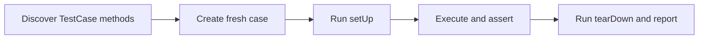

> **Level 2: Intermediate** · Topic 31 of 35

[← SQLAlchemy ORM](./30-sqlalchemy-orm.md) · [↑ Level index](../README.md) · [Pytest →](./32-pytest.md)

# Unit Testing

## Overview
- **What is it?** Unit Testing is the intermediate Python topic of testing small units with Python's standard-library unittest framework.
- **Why is it important?** unittest organizes TestCase classes, lifecycle methods, assertions, discovery, and mock integration without third-party tools.
- **Where is it used?** library regression suites, legacy test code, standard-library-only projects.

## Learning Objectives
- Write TestCase methods and assertions.
- Use setUp/tearDown and subTest appropriately.
- Contrast unittest class style with pytest function-and-fixture style.

## Real World Applications
- **Engineering:** Library regression suites rely on this topic.
- **Product work:** It supports legacy test code.
- **Operations:** It appears in standard-library-only projects.

## Core Concepts

### TestCase lifecycle
- **Definition:** unittest creates a fresh TestCase instance for each test method and runs setUp and tearDown around it.
- **Visual explanation:** ``new TestCase -> setUp -> test_* -> tearDown``
- **Practical example:**

```python
import unittest

class MathTests(unittest.TestCase):
    def test_sum(self):
        self.assertEqual(2 + 3, 5)
```

### Assertions
- **Definition:** TestCase assertions report structured differences and expected exceptions instead of relying on bare boolean output.
- **Visual explanation:** ``arrange -> act -> assertEqual/assertRaises``
- **Practical example:**

```python
with self.assertRaises(ValueError):
    int("invalid")
```

### Discovery and isolation
- **Definition:** python -m unittest discovers test modules; each test must control state and remain independent of execution order.
- **Visual explanation:** ``discovery -> isolated test methods -> report``
- **Practical example:**

```python
# python -m unittest discover -s tests -p "test_*.py"
```

## Infographic Summary

| Infographic Block | Topic-specific guidance |
| --- | --- |
| 📌 Concept | TestCase lifecycle, Assertions, Discovery and isolation |
| ⚡ Purpose | unittest organizes TestCase classes, lifecycle methods, assertions, discovery, and mock integration without third-party tools. |
| 🔥 Benefits | Standard-library test discovery, isolated lifecycle control, and structured regression assertions. |
| 🎯 Use Cases | library regression suites, legacy test code, standard-library-only projects |
| 🚀 Best Practices | Test observable behavior with one clear reason for failure per test. |
| ❌ Common Mistakes | Sharing mutable class or global state between tests. |

## Syntax Guide

### Basic Syntax

```python
import unittest

class SlugTests(unittest.TestCase):
    def test_spaces_become_hyphens(self):
        self.assertEqual(slugify("hello world"), "hello-world")
```

### Standard Structure

```python
class RepositoryTests(unittest.TestCase):
    def setUp(self):
        self.repository = MemoryRepository()

    def test_saved_item_can_be_loaded(self):
        self.repository.save("a", 1)
        self.assertEqual(self.repository.load("a"), 1)
```

### Code Pattern

```python
# Arrange one isolated starting state.
# Act through the unit's public interface.
# Assert the observable result or exception.
# unittest runner discovers test_* methods.
```

## Examples

### Beginner Example

```python
import unittest

def double(value):
    return value * 2

class DoubleTests(unittest.TestCase):
    def test_doubles_integer(self):
        self.assertEqual(double(4), 8)

if __name__ == "__main__":
    unittest.main()
```

### Intermediate Example

```python
import unittest

def percentage(part: float, total: float) -> float:
    if total == 0:
        raise ValueError("total cannot be zero")
    return part / total * 100

class PercentageTests(unittest.TestCase):
    def test_calculates_percentage(self):
        self.assertAlmostEqual(percentage(1, 4), 25.0)

    def test_rejects_zero_total(self):
        with self.assertRaisesRegex(ValueError, "cannot be zero"):
            percentage(3, 0)

    def test_multiple_ratios(self):
        for part, total, expected in ((1, 2, 50), (3, 4, 75)):
            with self.subTest(part=part, total=total):
                self.assertEqual(percentage(part, total), expected)
```

### Advanced Example

```python
import unittest
from unittest.mock import Mock

class RegistrationService:
    def __init__(self, repository, mailer):
        self.repository = repository
        self.mailer = mailer

    def register(self, email):
        user = self.repository.save(email)
        self.mailer.send_welcome(user)
        return user

class RegistrationTests(unittest.TestCase):
    def setUp(self):
        self.repository = Mock()
        self.mailer = Mock()
        self.service = RegistrationService(self.repository, self.mailer)

    def test_saves_then_sends_welcome(self):
        user = {"id": 7, "email": "ada@example.com"}
        self.repository.save.return_value = user
        self.assertIs(self.service.register(user["email"]), user)
        self.repository.save.assert_called_once_with(user["email"])
        self.mailer.send_welcome.assert_called_once_with(user)
```

## Workflow Diagram



---

[← SQLAlchemy ORM](./30-sqlalchemy-orm.md) · [↑ Level index](../README.md) · [Pytest →](./32-pytest.md)
