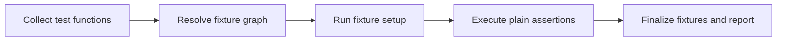

> **Level 2: Intermediate** · Topic 32 of 35

[← Unit Testing](./31-unit-testing.md) · [↑ Level index](../README.md) · [Mocking →](./33-mocking.md)

# Pytest

## Overview
- **What is it?** Pytest is a testing framework that uses plain assert statements, fixtures, and parametrization for concise tests.
- **Why is it important?** It reduces boilerplate and scales from unit tests to integration suites used across the Python ecosystem.
- **Where is it used?** Open-source libraries, web apps, data pipelines, and CI quality gates.

## Learning Objectives
- Write plain assert tests.
- Build scoped fixtures with cleanup.
- Parametrize cases and use pytest.raises.

## Real World Applications
- Parametrize validation rules across many input cases.
- Share database fixtures safely across integration tests.
- Generate clear failure reports for pull-request reviews.

## Core Concepts

### Assertion rewriting
- **Definition:** pytest rewrites assert statements during collection to show evaluated subexpressions on failure.
- **Visual explanation:** ``plain assert expression -> detailed failure explanation``
- **Practical example:**

```python
def test_total():
    assert sum([2, 3]) == 5
```

### Fixtures
- **Definition:** A fixture declares reusable setup by dependency name; yield fixtures run teardown after consumers finish.
- **Visual explanation:** ``test parameter -> fixture setup -> test -> teardown``
- **Practical example:**

```python
import pytest

@pytest.fixture
def records():
    return [{"id": 1}]
```

### Parametrization
- **Definition:** parametrize collects one test case per argument set, keeping behavior and edge cases visible.
- **Visual explanation:** ``one test function x case table -> many test items``
- **Practical example:**

```python
import pytest

@pytest.mark.parametrize("value", [1, 2, 3])
def test_positive(value):
    assert value > 0
```

## Infographic Summary

| Infographic Block | Topic-specific guidance |
| --- | --- |
| 📌 Concept | Pytest is a testing framework that uses plain assert statements, fixtures, and parametrization for concise tests. |
| ⚡ Purpose | pytest uses plain test functions, assertion rewriting, composable fixtures, and a rich plugin ecosystem. |
| 🔥 Benefits | Concise assertions, composable setup, and scalable data-driven test coverage. |
| 🎯 Use Cases | modern application suites, integration test fixtures, data-driven testing |
| 🚀 Best Practices | Keep fixture scope narrow and assert outcomes rather than implementation sequence. |
| ❌ Common Mistakes | Turning fixtures into hidden, autouse-heavy global setup. |

## Syntax Guide

### Basic Syntax

```python
def test_slugify():
    assert slugify("Hello World") == "hello-world"
```

### Standard Structure

```python
import pytest

@pytest.fixture
def repository():
    repo = Repository()
    yield repo
    repo.close()

def test_save(repository):
    repository.save("item")
    assert repository.count() == 1
```

### Code Pattern

```python
# pytest collects test_* functions.
# Fixture names declare setup dependencies.
# Plain assert states expected behavior.
# yield fixture performs guaranteed teardown.
```

## Examples

### Beginner Example

```python
def add_tax(amount: float, rate: float) -> float:
    return amount * (1 + rate)

def test_add_tax():
    assert add_tax(100, 0.2) == 120
```

### Intermediate Example

```python
import pytest

def parse_port(text: str) -> int:
    port = int(text)
    if not 1 <= port <= 65535:
        raise ValueError("port out of range")
    return port

@pytest.mark.parametrize(
    ("text", "expected"),
    [("80", 80), ("443", 443), ("8080", 8080)],
)
def test_parse_port(text, expected):
    assert parse_port(text) == expected

def test_parse_port_rejects_out_of_range():
    with pytest.raises(ValueError, match="out of range"):
        parse_port("70000")
```

### Advanced Example

```python
import pytest

class MemoryRepository:
    def __init__(self):
        self.items = []

    def close(self):
        self.closed = True

@pytest.fixture
def repository():
    value = MemoryRepository()
    yield value
    value.close()

@pytest.fixture
def populated_repository(repository):
    repository.items.extend(["alpha", "beta"])
    return repository

def test_repository_starts_populated(populated_repository):
    assert populated_repository.items == ["alpha", "beta"]
```

## Workflow Diagram



---

[← Unit Testing](./31-unit-testing.md) · [↑ Level index](../README.md) · [Mocking →](./33-mocking.md)
