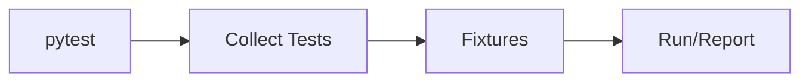

# Pytest

## Overview

- **What is it?** Pytest is a flexible testing framework with simple tests and powerful fixtures.
- **Why is it important?** It reduces boilerplate versus unittest and has rich plugin ecosystem.
- **Where is it used?** Open source Python, FastAPI/Django projects, libraries.

## Learning Objectives

- **Skills gained:** Practical command of Pytest.
- **Concepts covered:**

- Write test_ functions and assert.
- Use fixtures for setup/teardown.
- Parametrize tests for edge cases.

- **Expected outcome:** You build expressive test suites with pytest.

## Real World Applications

- Web APIs
- PyPI packages
- Data platforms
- ML pipelines

- **Business applications:** Automate workflows, reduce manual errors, accelerate delivery.
- **Career relevance:** Required knowledge for Python roles from junior developer to senior engineer.

## Core Concepts

### test_ prefix

- **Definition:** Auto-discovered tests.
- **Visual explanation:** `test_ prefix` → process → result
- **Practical example:**

```python
def test_sum():
    assert sum([1, 2]) == 3
test_sum()
```

### fixtures

- **Definition:** Reusable setup.
- **Visual explanation:** `fixtures` → process → result
- **Practical example:**

```python
def sample_data():
    return [1, 2, 3]
assert len(sample_data()) == 3
```

### parametrize

- **Definition:** Multiple inputs.
- **Visual explanation:** `parametrize` → process → result
- **Practical example:**

```python
cases = [(1, 2), (2, 4)]
for n, expected in cases:
    assert n * 2 == expected
```

## Infographic Summary

| Block | Summary |
| --- | --- |
| 📌 Concept | Pytest collects tests and runs with rich reporting. |
| ⚡ Purpose | Productive testing with minimal ceremony. |
| 🔥 Benefits | Fixtures, plugins, clear failures, parametrize. |
| 🎯 Use Cases | API tests, unit tests, snapshot testing. |
| 🚀 Best Practices | Use conftest.py; mark slow tests; isolate I/O. |
| ❌ Common Mistakes | Shared mutable fixtures, testing order dependence. |

## Syntax Guide

### Basic Syntax

```python
def test_example():
    assert True
```

### Standard Structure

```python
fixtures -> test functions -> pytest runner
```

### Code Pattern

```python
class Client:
    def post(self, path, json=None):
        return {'path': path, 'json': json}


def test_user_creation(client):
    return client.post('/users', json={'email': 'a@b.com'})


print(test_user_creation(Client()))
```

## Examples

### Beginner Example

```python
def test_upper():
    assert 'hi'.upper() == 'HI'
test_upper()
```

### Intermediate Example

```python
def pytest_style_double(n):
    return n * 2


def test_double():
    assert pytest_style_double(3) == 6
```

### Advanced Example

```python
def parametrize(cases):
    def decorator(func):
        def runner():
            for args in cases:
                func(*args)
        return runner
    return decorator


@parametrize([(2, 4), (3, 6)])
def test_double(n, expected):
    assert n * 2 == expected


test_double()
```

## Workflow Diagram



---
