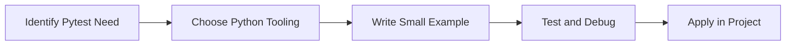

> **Level 2: Intermediate** · Topic 32 of 35

[← Unit Testing](./31-unit-testing.md) · [↑ Level index](../README.md) · [Mocking →](./33-mocking.md)

# Pytest

## Overview
- **What is it?** Pytest is a Python knowledge area focused on delivery quality.
- **Why is it important?** Help developers apply delivery quality techniques safely, clearly, and consistently.
- **Where is it used?** Reliable releases, automation tools, reusable packages, and developer productivity.

## Learning Objectives
- Gain the practical skill to explain, write, debug, and review pytest code.
- Cover the vocabulary, syntax, workflow, edge cases, and professional habits behind pytest.
- Expected outcome: you can use pytest in a small project and recognize when it belongs in production code.

## Real World Applications
- **Industry use cases:** Reliable releases, automation tools, reusable packages, and developer productivity.
- **Business applications:** Reduce manual work, improve reliability, support reporting, automate decisions, and ship maintainable features.
- **Career relevance:** Supports Python developer, backend engineer, data engineer, AI engineer, DevOps engineer, QA automation, and cybersecurity automation roles.

## Core Concepts

### Mental Model
- **Definition:** The main idea that gives pytest its structure and purpose inside a Python program.
- **Visual explanation:** `problem -> Pytest model -> clear code`
- **Practical example:**

```python
apply_pytest_label = "Pytest"
print(apply_pytest_label)
```

### Execution Flow
- **Definition:** The ordered steps Python follows when pytest code is created, executed, or integrated.
- **Visual explanation:** `input -> Python operation -> result -> feedback`
- **Practical example:**

```python
def increment(value):
    return value + 1

def test_increment():
    assert increment(2) == 3
```

### Quality Rule
- **Definition:** The reliability habit that keeps pytest understandable, testable, secure, and maintainable.
- **Visual explanation:** `working code -> validation -> production confidence`
- **Practical example:**

```python
import pytest

@pytest.mark.parametrize("raw,expected", [("1", 1), ("2", 2)])
def test_parse_int(raw, expected):
    assert int(raw) == expected
```

## Infographic Summary

| Infographic Block | Key Message |
| --- | --- |
| 📌 Concept | Pytest belongs to the delivery quality part of Python mastery. |
| ⚡ Purpose | Help developers apply delivery quality techniques safely, clearly, and consistently. |
| 🔥 Benefits | Stronger maintainability, better reliability, and more professional delivery quality decisions. |
| 🎯 Use Cases | Reliable releases, automation tools, reusable packages, and developer productivity. |
| 🚀 Best Practices | Prefer readable names, small examples, explicit errors, tests, documentation, and version-aware choices. |
| ❌ Common Mistakes | Copying code without understanding it, ignoring edge cases, skipping validation, and mixing unrelated responsibilities. |

## Syntax Guide

### Basic Syntax

```python
def test_total():
    assert sum([1, 2]) == 3
```

### Standard Structure

```python
def apply_pytest(value):
    """Apply the Pytest concept to one value."""
    return value

result = apply_pytest("practice")
print(result)
```

### Code Pattern

```python
# 1. Identify the Pytest problem
# 2. Apply the correct Python structure
# 3. Validate the result with tests or output
```

## Examples

### Beginner Example

```python
def increment(value):
    return value + 1

def test_increment():
    assert increment(2) == 3
```

### Intermediate Example

```python
import pytest

@pytest.mark.parametrize("raw,expected", [("1", 1), ("2", 2)])
def test_parse_int(raw, expected):
    assert int(raw) == expected
```

### Advanced Example

```python
import pytest

@pytest.fixture
def user():
    return {"role": "admin"}

def test_user_role(user):
    assert user["role"] == "admin"
```

## Workflow Diagram




---

---

[← Unit Testing](./31-unit-testing.md) · [↑ Level index](../README.md) · [Mocking →](./33-mocking.md)
