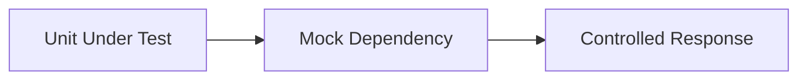

# Mocking

## Overview

- **What is it?** Mocking replaces real dependencies with test doubles during unit tests.
- **Why is it important?** Tests must be isolated from networks, databases, and non-determinism.
- **Where is it used?** Unit tests for services, API clients, time, randomness.

## Learning Objectives

- **Skills gained:** Practical command of Mocking.
- **Concepts covered:**

- Use unittest.mock.Mock and patch.
- Assert calls and return values.
- Avoid over-mocking internal details.

- **Expected outcome:** You test components in isolation with controlled dependencies.

## Real World Applications

- Microservices
- SDK development
- Payment integrations
- CI pipelines

- **Business applications:** Automate workflows, reduce manual errors, accelerate delivery.
- **Career relevance:** Required knowledge for Python roles from junior developer to senior engineer.

## Core Concepts

### Mock

- **Definition:** Fake object with methods.
- **Visual explanation:** `Mock` → process → result
- **Practical example:**

```python
from unittest.mock import Mock
m = Mock(return_value=42)
print(m())
```

### patch

- **Definition:** Replace symbol temporarily.
- **Visual explanation:** `patch` → process → result
- **Practical example:**

```python
from unittest.mock import patch
with patch('builtins.len', return_value=3):
    print(len([]))
```

### assert_called

- **Definition:** Verify interactions.
- **Visual explanation:** `assert_called` → process → result
- **Practical example:**

```python
from unittest.mock import Mock
m = Mock()
m.save('x')
m.save.assert_called_once_with('x')
```

## Infographic Summary

| Block | Summary |
| --- | --- |
| 📌 Concept | Mocks simulate collaborators with controlled behavior. |
| ⚡ Purpose | Isolate unit under test. |
| 🔥 Benefits | Fast, deterministic tests without external systems. |
| 🎯 Use Cases | API client tests, DB repository tests, clock control. |
| 🚀 Best Practices | Mock boundaries not internals; verify outcomes and key calls. |
| ❌ Common Mistakes | Mocking everything, brittle call assertions, patching wrong path. |

## Syntax Guide

### Basic Syntax

```python
from unittest.mock import Mock
service = Mock()
service.fetch.return_value = {'ok': True}
```

### Standard Structure

```python
patch dependency -> exercise code -> assert behavior
```

### Code Pattern

```python
from unittest.mock import patch


def flow(mock_call):
    mock_call.return_value = {'ok': True}
    return mock_call()


with patch('builtins.len', return_value=3):
    print(flow(len))
```

## Examples

### Beginner Example

```python
from unittest.mock import Mock

repo = Mock()
repo.get.return_value = {'id': 1}
print(repo.get(1)['id'])
```

### Intermediate Example

```python
from unittest.mock import patch


def send_email(client, to: str):
    return client.post('/email', json={'to': to})


class FakeClient:
    def post(self, path, json=None):
        return {'path': path, 'json': json}


with patch('builtins.print'):
    result = send_email(FakeClient(), 'a@b.com')
print(result['json']['to'])
```

### Advanced Example

```python
from unittest.mock import MagicMock


def process(payment_gateway, amount: float) -> str:
    receipt = payment_gateway.charge(amount)
    return receipt['id']


gateway = MagicMock()
gateway.charge.return_value = {'id': 'rcpt_123'}
print(process(gateway, 10.0))
```

## Workflow Diagram



---
