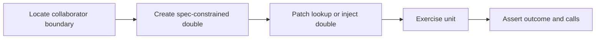

> **Level 2: Intermediate** · Topic 33 of 35

[← Pytest](./32-pytest.md) · [↑ Level index](../README.md) · [Packaging Python Projects →](./34-packaging-python-projects.md)

# Mocking

## Overview
- **What is it?** Mocking is the intermediate Python topic of replacing collaborators at test boundaries with controlled test doubles.
- **Why is it important?** unittest.mock isolates nondeterministic or external behavior, but excessive mocking couples tests to implementation.
- **Where is it used?** network failure simulation, time and randomness control, interaction verification.

## Learning Objectives
- Use Mock, patch, autospec, and side_effect.
- Patch where a name is looked up.
- Choose fakes or real collaborators when behavior matters.

## Real World Applications
- **Engineering:** Network failure simulation rely on this topic.
- **Product work:** It supports time and randomness control.
- **Operations:** It appears in interaction verification.

## Core Concepts

### Test doubles
- **Definition:** A mock records calls and returns configured values; stubs provide answers, while fakes provide a lightweight working implementation.
- **Visual explanation:** ``unit -> test double instead of external collaborator``
- **Practical example:**

```python
from unittest.mock import Mock
gateway = Mock()
gateway.charge.return_value = "paid"
```

### Patching lookup names
- **Definition:** patch temporarily rebinds the name used by code under test, which may differ from where the object was originally defined.
- **Visual explanation:** ``module_under_test.name -> patched object during scope``
- **Practical example:**

```python
from unittest.mock import patch

with patch("service.clock") as clock:
    clock.return_value = 100
```

### Specifications and side effects
- **Definition:** autospec constrains a mock to a real callable signature; side_effect can raise or produce sequential outcomes.
- **Visual explanation:** ``spec -> valid interface; side_effect -> result/error sequence``
- **Practical example:**

```python
from unittest.mock import Mock
client = Mock()
client.fetch.side_effect = [TimeoutError, {"ok": True}]
```

## Infographic Summary

| Infographic Block | Topic-specific guidance |
| --- | --- |
| 📌 Concept | Test doubles, Patching lookup names, Specifications and side effects |
| ⚡ Purpose | unittest.mock isolates nondeterministic or external behavior, but excessive mocking couples tests to implementation. |
| 🔥 Benefits | Deterministic boundary tests, reproducible failures, and precise collaborator interaction checks. |
| 🎯 Use Cases | network failure simulation, time and randomness control, interaction verification |
| 🚀 Best Practices | Mock narrow external boundaries and assert the business outcome first. |
| ❌ Common Mistakes | Patching the definition module when the code under test imported the name elsewhere. |

## Syntax Guide

### Basic Syntax

```python
from unittest.mock import Mock

mailer = Mock()
mailer.send.return_value = "queued"
result = mailer.send("ada@example.com")
```

### Standard Structure

```python
from unittest.mock import patch

with patch("orders.requests.get", autospec=True) as get:
    get.return_value.json.return_value = {"status": "ok"}
    result = orders.fetch_status()
```

### Code Pattern

```python
# Identify the external or nondeterministic boundary.
# Replace the name where the unit looks it up.
# Configure realistic result or failure.
# Assert outcome and only meaningful interactions.
```

## Examples

### Beginner Example

```python
from unittest.mock import Mock

notifier = Mock()
notifier.send.return_value = "message-7"
message_id = notifier.send("Build complete")
assert message_id == "message-7"
notifier.send.assert_called_once_with("Build complete")
```

### Intermediate Example

```python
from unittest.mock import Mock

def deliver(client, payload):
    response = client.post(payload)
    if response["status"] != "accepted":
        raise RuntimeError("delivery rejected")
    return response["id"]

client = Mock()
client.post.return_value = {"status": "accepted", "id": "evt-1"}
assert deliver(client, {"value": 4}) == "evt-1"
client.post.assert_called_once_with({"value": 4})
```

### Advanced Example

```python
from unittest.mock import create_autospec, patch

class Clock:
    def now(self) -> float:
        return 0.0

def issue_token(clock: Clock) -> dict:
    return {"issued_at": clock.now()}

clock = create_autospec(Clock, instance=True)
clock.now.side_effect = [100.0, 101.0]
assert issue_token(clock)["issued_at"] == 100.0
assert issue_token(clock)["issued_at"] == 101.0

with patch("time.sleep", autospec=True) as sleep:
    sleep(0.5)
    sleep.assert_called_once_with(0.5)
```

## Workflow Diagram



---

[← Pytest](./32-pytest.md) · [↑ Level index](../README.md) · [Packaging Python Projects →](./34-packaging-python-projects.md)
