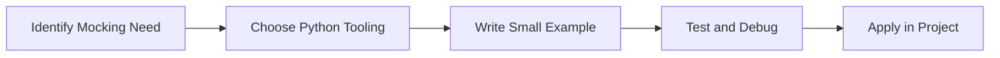

> **Level 2: Intermediate** · Topic 33 of 35

[← Pytest](./32-pytest.md) · [↑ Level index](../README.md) · [Packaging Python Projects →](./34-packaging-python-projects.md)

# Mocking

## Overview
- **What is it?** Mocking is a Python knowledge area focused on delivery quality.
- **Why is it important?** Help developers apply delivery quality techniques safely, clearly, and consistently.
- **Where is it used?** Reliable releases, automation tools, reusable packages, and developer productivity.

## Learning Objectives
- Gain the practical skill to explain, write, debug, and review mocking code.
- Cover the vocabulary, syntax, workflow, edge cases, and professional habits behind mocking.
- Expected outcome: you can use mocking in a small project and recognize when it belongs in production code.

## Real World Applications
- **Industry use cases:** Reliable releases, automation tools, reusable packages, and developer productivity.
- **Business applications:** Reduce manual work, improve reliability, support reporting, automate decisions, and ship maintainable features.
- **Career relevance:** Supports Python developer, backend engineer, data engineer, AI engineer, DevOps engineer, QA automation, and cybersecurity automation roles.

## Core Concepts

### Mental Model
- **Definition:** The main idea that gives mocking its structure and purpose inside a Python program.
- **Visual explanation:** `problem -> Mocking model -> clear code`
- **Practical example:**

```python
apply_mocking_label = "Mocking"
print(apply_mocking_label)
```

### Execution Flow
- **Definition:** The ordered steps Python follows when mocking code is created, executed, or integrated.
- **Visual explanation:** `input -> Python operation -> result -> feedback`
- **Practical example:**

```python
from unittest.mock import Mock
notify = Mock()
notify("sent")
notify.assert_called_once_with("sent")
```

### Quality Rule
- **Definition:** The reliability habit that keeps mocking understandable, testable, secure, and maintainable.
- **Visual explanation:** `working code -> validation -> production confidence`
- **Practical example:**

```python
from unittest.mock import patch

def get_clock():
    import time
    return time.time()

with patch("time.time", return_value=123.0):
    print(get_clock())
```

## Infographic Summary

| Infographic Block | Key Message |
| --- | --- |
| 📌 Concept | Mocking belongs to the delivery quality part of Python mastery. |
| ⚡ Purpose | Help developers apply delivery quality techniques safely, clearly, and consistently. |
| 🔥 Benefits | Stronger maintainability, better reliability, and more professional delivery quality decisions. |
| 🎯 Use Cases | Reliable releases, automation tools, reusable packages, and developer productivity. |
| 🚀 Best Practices | Prefer readable names, small examples, explicit errors, tests, documentation, and version-aware choices. |
| ❌ Common Mistakes | Copying code without understanding it, ignoring edge cases, skipping validation, and mixing unrelated responsibilities. |

## Syntax Guide

### Basic Syntax

```python
from unittest.mock import Mock
service = Mock(return_value="ok")
```

### Standard Structure

```python
def apply_mocking(value):
    """Apply the Mocking concept to one value."""
    return value

result = apply_mocking("practice")
print(result)
```

### Code Pattern

```python
# 1. Identify the Mocking problem
# 2. Apply the correct Python structure
# 3. Validate the result with tests or output
```

## Examples

### Beginner Example

```python
from unittest.mock import Mock
notify = Mock()
notify("sent")
notify.assert_called_once_with("sent")
```

### Intermediate Example

```python
from unittest.mock import patch

def get_clock():
    import time
    return time.time()

with patch("time.time", return_value=123.0):
    print(get_clock())
```

### Advanced Example

```python
from unittest.mock import create_autospec

class Gateway:
    def charge(self, amount: float) -> str:
        return "approved"

gateway = create_autospec(Gateway)
gateway.charge.return_value = "approved"
print(gateway.charge(10.0))
```

## Workflow Diagram




---

---

[← Pytest](./32-pytest.md) · [↑ Level index](../README.md) · [Packaging Python Projects →](./34-packaging-python-projects.md)
