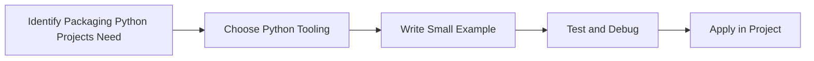

> **Level 2: Intermediate** · Topic 34 of 35

[← Mocking](./33-mocking.md) · [↑ Level index](../README.md) · [CLI Applications →](./35-cli-applications.md)

# Packaging Python Projects

## Overview
- **What is it?** Packaging Python Projects is a Python knowledge area focused on delivery quality.
- **Why is it important?** Help developers apply delivery quality techniques safely, clearly, and consistently.
- **Where is it used?** Reliable releases, automation tools, reusable packages, and developer productivity.

## Learning Objectives
- Gain the practical skill to explain, write, debug, and review packaging python projects code.
- Cover the vocabulary, syntax, workflow, edge cases, and professional habits behind packaging python projects.
- Expected outcome: you can use packaging python projects in a small project and recognize when it belongs in production code.

## Real World Applications
- **Industry use cases:** Reliable releases, automation tools, reusable packages, and developer productivity.
- **Business applications:** Reduce manual work, improve reliability, support reporting, automate decisions, and ship maintainable features.
- **Career relevance:** Supports Python developer, backend engineer, data engineer, AI engineer, DevOps engineer, QA automation, and cybersecurity automation roles.

## Core Concepts

### Mental Model
- **Definition:** The main idea that gives packaging python projects its structure and purpose inside a Python program.
- **Visual explanation:** `problem -> Packaging Python Projects model -> clear code`
- **Practical example:**

```python
apply_packaging_python_projects_label = "Packaging Python Projects"
print(apply_packaging_python_projects_label)
```

### Execution Flow
- **Definition:** The ordered steps Python follows when packaging python projects code is created, executed, or integrated.
- **Visual explanation:** `input -> Python operation -> result -> feedback`
- **Practical example:**

```python
import platform
print(platform.python_version())
```

### Quality Rule
- **Definition:** The reliability habit that keeps packaging python projects understandable, testable, secure, and maintainable.
- **Visual explanation:** `working code -> validation -> production confidence`
- **Practical example:**

```python
import sys

if sys.version_info < (3, 12):
    raise RuntimeError("Python 3.12 or newer is recommended")
print("Python version is ready")
```

## Infographic Summary

| Infographic Block | Key Message |
| --- | --- |
| 📌 Concept | Packaging Python Projects belongs to the delivery quality part of Python mastery. |
| ⚡ Purpose | Help developers apply delivery quality techniques safely, clearly, and consistently. |
| 🔥 Benefits | Stronger maintainability, better reliability, and more professional delivery quality decisions. |
| 🎯 Use Cases | Reliable releases, automation tools, reusable packages, and developer productivity. |
| 🚀 Best Practices | Prefer readable names, small examples, explicit errors, tests, documentation, and version-aware choices. |
| ❌ Common Mistakes | Copying code without understanding it, ignoring edge cases, skipping validation, and mixing unrelated responsibilities. |

## Syntax Guide

### Basic Syntax

```bash
python -m build
python -m twine upload dist/*
```

### Standard Structure

```python
def apply_packaging_python_projects(value):
    """Apply the Packaging Python Projects concept to one value."""
    return value

result = apply_packaging_python_projects("practice")
print(result)
```

### Code Pattern

```python
# 1. Identify the Packaging Python Projects problem
# 2. Apply the correct Python structure
# 3. Validate the result with tests or output
```

## Examples

### Beginner Example

```python
import platform
print(platform.python_version())
```

### Intermediate Example

```python
import sys

if sys.version_info < (3, 12):
    raise RuntimeError("Python 3.12 or newer is recommended")
print("Python version is ready")
```

### Advanced Example

```python
from pathlib import Path
import sys

project = Path.cwd()
print({"python": sys.version.split()[0], "project": project.name})
```

## Workflow Diagram




---

---

[← Mocking](./33-mocking.md) · [↑ Level index](../README.md) · [CLI Applications →](./35-cli-applications.md)
