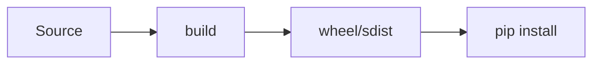

# Packaging Python Projects

## Overview

- **What is it?** Packaging Python projects prepares installable distributions with metadata and entry points.
- **Why is it important?** Packaging enables pip install, versioning, and publishing to PyPI.
- **Where is it used?** Open source libraries, internal packages, CLI tools.

## Learning Objectives

- **Skills gained:** Practical command of Packaging Python Projects.
- **Concepts covered:**

- Configure pyproject.toml with build backend.
- Declare dependencies and optional extras.
- Build wheels and sdist.

- **Expected outcome:** You build and publish Python packages correctly.

## Real World Applications

- PyPI ecosystem
- Enterprise internal PyPI
- CLI products
- SDK vendors

- **Business applications:** Automate workflows, reduce manual errors, accelerate delivery.
- **Career relevance:** Required knowledge for Python roles from junior developer to senior engineer.

## Core Concepts

### pyproject.toml

- **Definition:** Project metadata and tools.
- **Visual explanation:** `pyproject.toml` → process → result
- **Practical example:**

```python
print('[project]' in '[project]\nname="demo"')
```

### wheel

- **Definition:** Built distribution format.
- **Visual explanation:** `wheel` → process → result
- **Practical example:**

```python
print('whl' in 'package-1.0-py3-none-any.whl')
```

### entry points

- **Definition:** Console scripts.
- **Visual explanation:** `entry points` → process → result
- **Practical example:**

```python
ENTRY = {'console_scripts': ['mycli=mypkg.cli:main']}
print(ENTRY['console_scripts'][0].split('=')[0])
```

## Infographic Summary

| Block | Summary |
| --- | --- |
| 📌 Concept | Build backends produce standardized artifacts. |
| ⚡ Purpose | Share and install Python code reliably. |
| 🔥 Benefits | Version pinning, dependency resolution, script installation. |
| 🎯 Use Cases | Libraries, CLIs, plugins. |
| 🚀 Best Practices | Semantic versioning; README on PyPI; classifiers; license file. |
| ❌ Common Mistakes | Missing MANIFEST/pyproject deps, not testing install in clean venv. |

## Syntax Guide

### Basic Syntax

```python
[project]
name = "my-package"
version = "0.1.0"
```

### Standard Structure

```python
src layout -> pyproject -> build -> publish
```

### Code Pattern

```python
commands = ['python', '-m', 'build']
print(' '.join(commands))
```

## Examples

### Beginner Example

```python
from pathlib import Path
print(Path('scripts/generate_all_snippets.py').exists())
```

### Intermediate Example

```python
METADATA = {
    'name': 'demo_pkg',
    'version': '0.1.0',
    'dependencies': ['requests>=2.0'],
}
print(METADATA['name'])
```

### Advanced Example

```python
def build_console_script(module: str, func: str = 'main') -> str:
    return f'{module.split('.')[-1]}={module}:{func}'


print(build_console_script('myapp.cli'))
```

## Workflow Diagram



---
