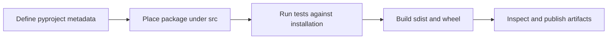

> **Level 2: Intermediate** · Topic 34 of 35

[← Mocking](./33-mocking.md) · [↑ Level index](../README.md) · [CLI Applications →](./35-cli-applications.md)

# Packaging Python Projects

## Overview
- **What is it?** Packaging Python Projects is the intermediate Python topic of building installable Python distributions from a pyproject.toml and src layout.
- **Why is it important?** Modern packaging separates build metadata, import packages, distributions, and isolated build backends.
- **Where is it used?** reusable libraries, internal tools, PyPI distributions.

## Learning Objectives
- Create pyproject.toml metadata.
- Use a src layout to test installed imports.
- Build and inspect wheel and source distributions.

## Real World Applications
- **Engineering:** Reusable libraries rely on this topic.
- **Product work:** It supports internal tools.
- **Operations:** It appears in PyPI distributions.

## Core Concepts

### Project metadata
- **Definition:** pyproject.toml declares the build backend and standardized project name, version, Python requirement, dependencies, and entry points.
- **Visual explanation:** ``pyproject.toml -> build backend -> distribution metadata``
- **Practical example:**

```python
from pathlib import Path
metadata = Path("pyproject.toml").read_text(encoding="utf-8")
print("[project]" in metadata)
```

### Source layout
- **Definition:** A src layout places import packages under src/, preventing tests from accidentally importing the working tree instead of the installed project.
- **Visual explanation:** ``project/src/package -> installation -> site-packages/package``
- **Practical example:**

```python
from pathlib import Path
package = Path("src/learning_tools/__init__.py")
print(package.as_posix())
```

### Distribution artifacts
- **Definition:** A build creates a source distribution and platform-appropriate wheel; consumers install the distribution and import its package name.
- **Visual explanation:** ``source tree -> sdist + wheel -> installer -> import package``
- **Practical example:**

```python
from pathlib import Path
artifacts = list(Path("dist").glob("*"))
print([path.suffix for path in artifacts])
```

## Infographic Summary

| Infographic Block | Topic-specific guidance |
| --- | --- |
| 📌 Concept | Project metadata, Source layout, Distribution artifacts |
| ⚡ Purpose | Modern packaging separates build metadata, import packages, distributions, and isolated build backends. |
| 🔥 Benefits | Reproducible builds, clean installed imports, and distributable versioned artifacts. |
| 🎯 Use Cases | reusable libraries, internal tools, PyPI distributions |
| 🚀 Best Practices | Build in isolation, test the wheel in a clean environment, and publish immutable versions. |
| ❌ Common Mistakes | Confusing the distribution name with the import package or importing from the repository root in tests. |

## Syntax Guide

### Basic Syntax

```toml
[build-system]
requires = ["hatchling"]
build-backend = "hatchling.build"

[project]
name = "learning-tools"
version = "0.1.0"
requires-python = ">=3.12"
```

### Standard Structure

```text
learning-tools/
├── pyproject.toml
├── README.md
├── src/
│   └── learning_tools/
│       ├── __init__.py
│       └── cli.py
└── tests/
    └── test_cli.py
```

### Code Pattern

```bash
python -m build
python -m venv /tmp/package-check
/tmp/package-check/bin/python -m pip install dist/*.whl
/tmp/package-check/bin/python -c "import learning_tools"
```

## Examples

### Beginner Example

```python
# src/learning_tools/version.py
__version__ = "0.1.0"

def version_message() -> str:
    return f"learning-tools {__version__}"

print(version_message())
```

### Intermediate Example

```python
# src/learning_tools/slug.py
import re

def slugify(value: str) -> str:
    normalized = value.strip().casefold()
    return re.sub(r"[^a-z0-9]+", "-", normalized).strip("-")

if __name__ == "__main__":
    print(slugify("Packaged Python Tool"))
```

### Advanced Example

```python
# src/learning_tools/cli.py
import argparse
from importlib.metadata import version

def main(arguments=None) -> int:
    parser = argparse.ArgumentParser(prog="learning-tools")
    parser.add_argument("--version", action="store_true")
    options = parser.parse_args(arguments)
    if options.version:
        print(version("learning-tools"))
    return 0

if __name__ == "__main__":
    raise SystemExit(main())
```

## Workflow Diagram



---

[← Mocking](./33-mocking.md) · [↑ Level index](../README.md) · [CLI Applications →](./35-cli-applications.md)
