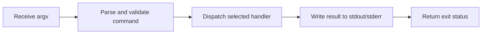

> **Level 2: Intermediate** · Topic 35 of 35

[← Packaging Python Projects](./34-packaging-python-projects.md) · [↑ Level index](../README.md)

# CLI Applications

## Overview
- **What is it?** CLI applications provide composable command-line interfaces using argparse or similar libraries.
- **Why is it important?** Operators and developers need scriptable tools that integrate with shells, CI, and automation.
- **Where is it used?** DevOps tooling, data utilities, admin commands, and developer productivity scripts.

## Learning Objectives
- Design options, arguments, and subcommands.
- Separate parsing from command behavior.
- Use stdout, stderr, and exit statuses predictably.

## Real World Applications
- Build deploy helpers with subcommands and exit codes.
- Expose batch processors that ops can schedule safely.
- Add --dry-run and verbose flags for safer production use.

## Core Concepts

### Argument contract
- **Definition:** A CLI contract defines command names, positional arguments, options, defaults, help, and validation.
- **Visual explanation:** ``argv -> argparse parser -> Namespace``
- **Practical example:**

```python
import argparse
parser = argparse.ArgumentParser()
parser.add_argument("--verbose", action="store_true")
options = parser.parse_args([])
```

### Command dispatch
- **Definition:** Subparsers map explicit commands to handler functions while keeping business logic independently callable.
- **Visual explanation:** ``subcommand -> selected handler -> service``
- **Practical example:**

```python
parser = argparse.ArgumentParser()
commands = parser.add_subparsers(dest="command", required=True)
commands.add_parser("status")
```

### Streams and exit status
- **Definition:** Normal machine-readable output goes to stdout, diagnostics go to stderr, and zero/nonzero status reports success/failure.
- **Visual explanation:** ``result -> stdout + exit 0 | error -> stderr + nonzero``
- **Practical example:**

```python
import sys
print("invalid input", file=sys.stderr)
status = 2
```

## Infographic Summary

| Infographic Block | Topic-specific guidance |
| --- | --- |
| 📌 Concept | CLI applications provide composable command-line interfaces using argparse or similar libraries. |
| ⚡ Purpose | A CLI translates shell arguments into validated application commands, writes results to the correct stream, and signals outcomes with exit codes. |
| 🔥 Benefits | Discoverable command contracts, automation-friendly output, and testable command dispatch. |
| 🎯 Use Cases | developer tooling, automation scripts, administrative utilities |
| 🚀 Best Practices | Keep main(arguments=None) testable and return an integer status. |
| ❌ Common Mistakes | Mixing argument parsing, database access, and formatting in one function. |

## Syntax Guide

### Basic Syntax

```python
import argparse

parser = argparse.ArgumentParser()
parser.add_argument("name")
args = parser.parse_args()
print(f"Hello, {args.name}")
```

### Standard Structure

```python
def build_parser():
    parser = argparse.ArgumentParser(prog="tasks")
    subcommands = parser.add_subparsers(required=True)
    add = subcommands.add_parser("add")
    add.add_argument("title")
    add.set_defaults(handler=handle_add)
    return parser
```

### Code Pattern

```python
# Build parser and document the contract.
# Parse argv into typed values.
# Dispatch to a separately testable handler.
# Print to correct stream and return an exit code.
```

## Examples

### Beginner Example

```python
import argparse

parser = argparse.ArgumentParser(description="Greet one person")
parser.add_argument("name")
args = parser.parse_args(["Ada"])
print(f"Hello, {args.name}")
```

### Intermediate Example

```python
import argparse

def parse_arguments(arguments=None):
    parser = argparse.ArgumentParser(prog="convert")
    parser.add_argument("value", type=float)
    parser.add_argument("--scale", type=float, default=1.0)
    return parser.parse_args(arguments)

def main(arguments=None) -> int:
    options = parse_arguments(arguments)
    print(options.value * options.scale)
    return 0

if __name__ == "__main__":
    raise SystemExit(main())
```

### Advanced Example

```python
import argparse
import sys

def handle_add(options) -> int:
    if not options.title.strip():
        print("title cannot be blank", file=sys.stderr)
        return 2
    print(f"added: {options.title.strip()}")
    return 0

def handle_list(options) -> int:
    print("\n".join(options.items))
    return 0

def build_parser() -> argparse.ArgumentParser:
    parser = argparse.ArgumentParser(prog="tasks")
    commands = parser.add_subparsers(required=True)
    add = commands.add_parser("add")
    add.add_argument("title")
    add.set_defaults(handler=handle_add)
    listing = commands.add_parser("list")
    listing.set_defaults(handler=handle_list, items=["learn", "test"])
    return parser

def main(arguments=None) -> int:
    options = build_parser().parse_args(arguments)
    return options.handler(options)

if __name__ == "__main__":
    raise SystemExit(main())
```

## Workflow Diagram



---

[← Packaging Python Projects](./34-packaging-python-projects.md) · [↑ Level index](../README.md)
