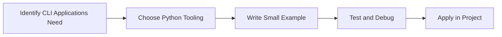

> **Level 2: Intermediate** · Topic 35 of 35

[← Packaging Python Projects](./34-packaging-python-projects.md) · [↑ Level index](../README.md)

# CLI Applications

## Overview
- **What is it?** CLI Applications is a Python knowledge area focused on delivery quality.
- **Why is it important?** Help developers apply delivery quality techniques safely, clearly, and consistently.
- **Where is it used?** Reliable releases, automation tools, reusable packages, and developer productivity.

## Learning Objectives
- Gain the practical skill to explain, write, debug, and review cli applications code.
- Cover the vocabulary, syntax, workflow, edge cases, and professional habits behind cli applications.
- Expected outcome: you can use cli applications in a small project and recognize when it belongs in production code.

## Real World Applications
- **Industry use cases:** Reliable releases, automation tools, reusable packages, and developer productivity.
- **Business applications:** Reduce manual work, improve reliability, support reporting, automate decisions, and ship maintainable features.
- **Career relevance:** Supports Python developer, backend engineer, data engineer, AI engineer, DevOps engineer, QA automation, and cybersecurity automation roles.

## Core Concepts

### Mental Model
- **Definition:** The main idea that gives cli applications its structure and purpose inside a Python program.
- **Visual explanation:** `problem -> CLI Applications model -> clear code`
- **Practical example:**

```python
apply_cli_applications_label = "CLI Applications"
print(apply_cli_applications_label)
```

### Execution Flow
- **Definition:** The ordered steps Python follows when cli applications code is created, executed, or integrated.
- **Visual explanation:** `input -> Python operation -> result -> feedback`
- **Practical example:**

```python
import argparse

parser = argparse.ArgumentParser()
parser.add_argument("--name", default="Python")
args = parser.parse_args([])
print(args.name)
```

### Quality Rule
- **Definition:** The reliability habit that keeps cli applications understandable, testable, secure, and maintainable.
- **Visual explanation:** `working code -> validation -> production confidence`
- **Practical example:**

```python
import argparse

def build_parser():
    parser = argparse.ArgumentParser()
    parser.add_argument("count", type=int)
    return parser

args = build_parser().parse_args(["3"])
print(args.count * 2)
```

## Infographic Summary

| Infographic Block | Key Message |
| --- | --- |
| 📌 Concept | CLI Applications belongs to the delivery quality part of Python mastery. |
| ⚡ Purpose | Help developers apply delivery quality techniques safely, clearly, and consistently. |
| 🔥 Benefits | Stronger maintainability, better reliability, and more professional delivery quality decisions. |
| 🎯 Use Cases | Reliable releases, automation tools, reusable packages, and developer productivity. |
| 🚀 Best Practices | Prefer readable names, small examples, explicit errors, tests, documentation, and version-aware choices. |
| ❌ Common Mistakes | Copying code without understanding it, ignoring edge cases, skipping validation, and mixing unrelated responsibilities. |

## Syntax Guide

### Basic Syntax

```python
import argparse
parser = argparse.ArgumentParser()
parser.add_argument("name")
```

### Standard Structure

```python
def apply_cli_applications(value):
    """Apply the CLI Applications concept to one value."""
    return value

result = apply_cli_applications("practice")
print(result)
```

### Code Pattern

```python
# 1. Identify the CLI Applications problem
# 2. Apply the correct Python structure
# 3. Validate the result with tests or output
```

## Examples

### Beginner Example

```python
import argparse

parser = argparse.ArgumentParser()
parser.add_argument("--name", default="Python")
args = parser.parse_args([])
print(args.name)
```

### Intermediate Example

```python
import argparse

def build_parser():
    parser = argparse.ArgumentParser()
    parser.add_argument("count", type=int)
    return parser

args = build_parser().parse_args(["3"])
print(args.count * 2)
```

### Advanced Example

```python
import argparse

parser = argparse.ArgumentParser(prog="portal")
subcommands = parser.add_subparsers(dest="command", required=True)
run = subcommands.add_parser("run")
run.add_argument("--dry-run", action="store_true")
print(parser.parse_args(["run", "--dry-run"]))
```

## Workflow Diagram




---

---

## Level 3: Advanced

Move from coding fluency into architecture, platforms, data systems, AI, performance, and production operations.

---

[← Packaging Python Projects](./34-packaging-python-projects.md) · [↑ Level index](../README.md)
